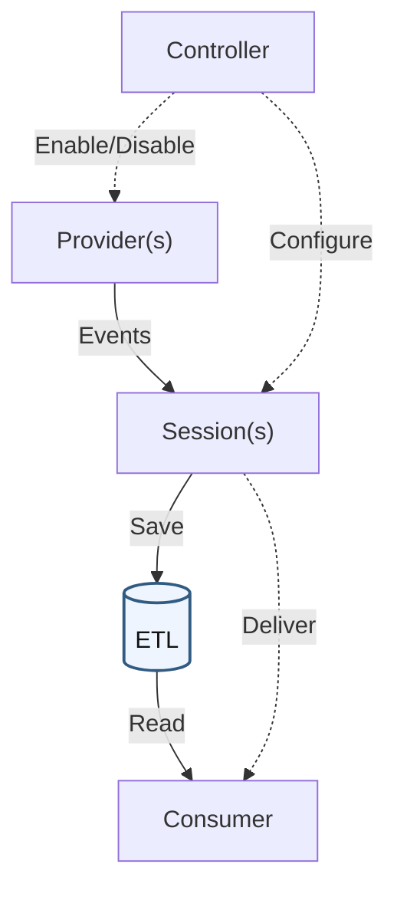

# The World Ends with ETW
How to Investigate ETL (Event Trace Log) Files

## Introduction

When it comes to Windows logs, the first thing that usually comes to mind is Event Logs in EVTX format. But there's another type of log called ETL (Event Trace Log), too (though it's not nearly as well known).

ETL files are used for Windows diagnostics, application debugging, performance analysis, and more. They can contain detailed records of system activity, including processes, file operations, and network communication, making them another useful source of information for Windows forensics.

If you've ever investigated Windows Event Logs, you probably know that the information you want is often missing.

By default, detailed process activity, file operations, and network communication may not be recorded. Logs may also have been deleted by an attacker or overwritten due to rotation settings, leaving only the last hour or two of activity. None of this is particularly unusual.

On the other hand, ETL files may contain more detailed information than Event Logs. Sometimes, even when the Event Logs have been deleted, the ETL files are still there.

In this article, I'll go over what ETW and ETL actually are and share some tips for investigating ETL files.

## 1. ETW Overview

### What is ETW?

ETW (Event Tracing for Windows) is a Windows **mechanism** for collecting events emitted by the operating system and applications. **ETL (Event Trace Log) is the file format used to store the collected events.**

ETW was introduced in Windows 2000 and [significantly expanded in Windows Vista](https://learn.microsoft.com/en-us/archive/msdn-magazine/2007/april/event-tracing-improve-debugging-and-performance-tuning-with-etw).

With Windows Vista, the event publishing model was integrated with Windows Event Log, allowing events to be handled through a shared infrastructure.

**This article focuses on ETW in Windows Vista and later.**

### How Does It Differ from Windows Event Logs?

Windows Event Log and ETW share parts of the underlying event publishing infrastructure. The main difference is how events are collected and stored.

Windows Event Log saves events assigned to [channels](https://learn.microsoft.com/en-us/windows/win32/wes/defining-channels) in EVTX files. ETW, on the other hand, collects events through **sessions**, which can write them to ETL files or deliver them to consumers in real time.

For example, a system might record an error message in an Event Log while collecting the beginning and end of the corresponding operation in a separate ETW session. In that case, the EVTX file would contain the error, while the ETL file would contain information about the operations surrounding it.

The same event may appear in both, depending on the collection configuration. This means that an ETL file may contain process activity, file operations, or network destinations that are absent from the EVTX files.

That said, tools such as [Sysmon](https://learn.microsoft.com/en-us/sysinternals/downloads/sysmon) can also record detailed information in EVTX files, so ETL is not necessarily more detailed in every case.

### ETW Components

ETW consists of the following components.

| Component | Role | Example |
| --- | --- | --- |
| Provider | The source that emits events | Windows components and applications, such as `Microsoft-Windows-DNS-Client` |
| Session | Collects events and delivers them to ETL files or consumers | A trace session configured with specific providers and output settings |
| Controller | Starts and stops sessions, enables providers, and configures collection settings | `logman.exe`, Windows Performance Recorder |
| Consumer | Reads collected events | Real-time monitoring tools and utilities that analyze existing ETL files |

The following diagram provides a simplified overview of these components and how events flow between them. Solid arrows represent event flow, while dashed arrows represent configuration operations. The ETL file highlighted in blue is what we'll be investigating in this article.



First, the Controller starts and stops sessions, enables or disables Providers, and configures collection settings. Typical Controllers include `logman.exe` and Windows Performance Recorder.

When a Controller enables a Provider, the Provider emits events. These events are filtered according to the conditions configured by the Controller, such as Level (severity), Keyword (category), and the Providers selected for collection, before being delivered to a Session.

The events are first collected in memory buffers, which are then used to write ETL files or deliver events to Consumers in real time.

A single Session can collect events from multiple Providers. Multiple Sessions can also run at the same time, and events emitted by the same Provider may be delivered to several Sessions and saved in separate ETL files.

Each Session has its own collection and storage settings. In circular logging, older data is overwritten. When investigating an ETL file, it is therefore worth checking not only its filename but also the Providers it contains and the time range it covers.

For a more detailed diagram, see Microsoft's [ETW Architecture](https://learn.microsoft.com/en-us/windows-hardware/test/weg/instrumenting-your-code-with-etw).

## 2. Preserving ETL Files

ETL files can be stored in all sorts of locations, depending on the application and its configuration.

When collecting evidence, you can search the system and copy the files directly, or use an acquisition tool that supports ETL collection.

### Live Acquisition

#### Using Built-in Windows Tools

You can use Windows' built-in [robocopy](https://learn.microsoft.com/en-us/windows-server/administration/windows-commands/robocopy) to copy all files matching `*.etl*` from `C:\` to `E:\Cases\etls`, preserving their relative paths.

Run the following commands with administrator privileges.

```powershell
New-Item -ItemType Directory -Path 'E:\Cases' -Force | Out-Null
robocopy C:\ E:\Cases\etls *.etl* /S /COPY:DAT /DCOPY:DAT /R:0 /W:0 /XJ /UNILOG:E:\Cases\etl-copy.log
```

| Option | Description |
| --- | --- |
| `/COPY:DAT` | Copies file data, attributes, and timestamps |
| `/DCOPY:DAT` | Copies directory data, attributes, and timestamps |
| `/XJ` | Excludes junction points |
| `/R:0` | Disables retries |

Check `etl-copy.log` for files that could not be copied due to access restrictions, open handles, or other errors.

Note that `/COPY:DAT` does not preserve access control lists (ACLs), ownership, or other security metadata. This example is intended for collecting ETL files rather than performing a complete forensic acquisition.

After copying the files, it's a good idea to calculate and record SHA-256 hashes so their integrity can be verified later.

As mentioned earlier, events are initially collected in memory buffers. This method only captures data that has already been written to disk.

If you also want to investigate events that have not yet been written to an ETL file, another option is to acquire a memory image and use [`etw-scan`](https://blogs.jpcert.or.jp/ja/2024/11/etw_forensics.html), a Volatility 3 plugin.

However, not every event can necessarily be recovered from memory.

#### Using Acquisition Tools

Ideally, I'd prefer to collect everything with an acquisition tool, but tools with comprehensive ETL collection support still seem somewhat limited.

[KAPE](https://github.com/EricZimmerman/KapeDocs) can collect related files using predefined Targets. Depending on the selected Targets, it can collect not only ETL files but also registry information and other artifacts from the source system.

Be aware that [KAPE has restrictions on commercial use](https://github.com/EricZimmerman/KapeDocs/blob/master/Pages/50-Frequently-asked-questions.md).

| Target | Main Collection Targets |
| --- | --- |
| `EventTraceLogs` | ETL files related to WDI, WMI, SleepStudy, Delivery Optimization, and others |
| `WindowsUpdate` | Windows Update ETL files, ETL files under `USOShared\Logs\System`, CBS logs, and related files |
| `RDPJumplist` | The package directory for the Store version of Remote Desktop, including `LocalState\Logs` |
| `RegistryHivesSystem` | System registry hives such as SYSTEM and SOFTWARE, along with transaction logs |

Again, run this with administrator privileges.

```powershell
.\kape.exe --tsource C: --tdest 'E:\Cases\KAPE' --target 'EventTraceLogs,WindowsUpdate,RDPJumplist,RegistryHivesSystem' --tdd false
```

The `--tdd false` option prevents files with identical contents but different paths from being deduplicated.

Of course, these Targets won't collect every ETL file on the system. You may need to add custom collection definitions or acquire certain files separately.

[Velociraptor](https://triage.velocidex.com/docs/windows.triage.targets/) also provides `Windows.Triage.Targets`, which includes collection definitions derived from KapeFiles.

I haven't used it myself yet, but it may be a good alternative if you're already familiar with Velociraptor.

### Acquiring ETL Files from Disk Images

One of the most reliable approaches is still to acquire a disk image.

Memory-resident information will be lost unless it is collected separately, but having a disk image means you can return to the evidence and extract additional artifacts later. It's worth considering, especially when the number of target systems is relatively small.

To search for and extract files directly from disk images, you can use [ntfsfind](https://github.com/sumeshi/ntfsfind) and [ntfsdump](https://github.com/sumeshi/ntfsdump).

As an example, I used `ntfsfind` to search for `.etl` files in the disk image from NIST's [CFReDS Data Leakage Case](https://cfreds-archive.nist.gov/data_leakage_case/data-leakage-case.html).

Here are the results.

```console
> ntfsfind.exe cfreds_2015_data_leakage_pc.E01 -e etl
/Windows/System32/LogFiles/WMI/RtBackup/EtwRTEventlog-Security.etl
/Windows/System32/LogFiles/WMI/RtBackup/EtwRTEventLog-Application.etl
/Windows/System32/wdi/{67144949-5132-4859-8036-a737b43825d8}/{9a3d7e9e-7fc6-43a4-a74e-8d50303fcdae}/snapshot.etl
/Windows/System32/wdi/{67144949-5132-4859-8036-a737b43825d8}/{ac1aa789-a259-4e50-be32-58447f92b714}/snapshot.etl
/Windows/System32/wdi/{86432a0b-3c7d-4ddf-a89c-172faa90485d}/{d3f5594e-34ec-4579-b2ed-9b3aa4a561f9}/snapshot.etl
/Users/informant/AppData/Local/Microsoft/Windows/Explorer/ExplorerStartupLog.etl
/Users/informant/AppData/Local/Microsoft/Windows/Explorer/ExplorerStartupLog_RunOnce.etl
/Windows/System32/LogFiles/WMI/RtBackup/EtwRTUBPM.etl
/Windows/Performance/WinSAT/DataStore/2015-03-24 11.11.25.240.winsat.etl
/Windows/System32/wdi/{86432a0b-3c7d-4ddf-a89c-172faa90485d}/{8c8a5498-1428-4a4f-9a52-aa2105754f70}/snapshot.etl
/Windows/System32/wdi/{86432a0b-3c7d-4ddf-a89c-172faa90485d}/{9e840662-7805-40ea-abbc-2666b58e80f3}/snapshot.etl
/Windows/System32/umstartup.etl
/Windows/System32/umstartup000.etl
/Windows/System32/LogFiles/WMI/Terminal-Services-Core.etl
/Windows/System32/LogFiles/WMI/Terminal-Services-IP-Virtualization.etl
/Windows/System32/LogFiles/WMI/Terminal-Services-RPC-Client.etl
/Windows/System32/LogFiles/WMI/Terminal-Services-SessionEnv.etl
/Windows/System32/LogFiles/WMI/Terminal-Services-Unified-APIs.etl
/Windows/System32/LogFiles/WMI/RtBackup/EtwRTDiagLog.etl
/Windows/System32/LogFiles/WMI/RtBackup/EtwRTEventLog-System.etl
/Windows/System32/wdi/LogFiles/BootCKCL.etl
/Windows/System32/wdi/LogFiles/ShutdownCKCL.etl
/Windows/System32/wfp/wfpdiag.etl
/Windows/System32/wdi/{86432a0b-3c7d-4ddf-a89c-172faa90485d}/{dc425e1a-3399-4a2e-9a96-e67a64c9ffd2}/snapshot.etl
/Windows/System32/wdi/{86432a0b-3c7d-4ddf-a89c-172faa90485d}/{3aaf5c18-c3df-412f-921f-a7c03ea7e145}/snapshot.etl
/Windows/System32/wdi/{86432a0b-3c7d-4ddf-a89c-172faa90485d}/{336c8a0e-f419-4df4-b3fe-52de057e5cae}/snapshot.etl
/Windows/Panther/setup.etl
/Windows/System32/winevt/Logs/DebugChannel.etl
/Windows/System32/winevt/Logs/Microsoft-RMS-MSIPC%4Debug.etl
/Users/admin11/AppData/Local/Microsoft/Windows/Explorer/ExplorerStartupLog.etl
/Users/temporary/AppData/Local/Microsoft/Windows/Explorer/ExplorerStartupLog.etl
/ProgramData/Microsoft/Windows/Power Efficiency Diagnostics/energy-trace.etl
/ProgramData/Microsoft/Windows/Power Efficiency Diagnostics/energy-ntkl.etl
/Windows/System32/wdi/{86432a0b-3c7d-4ddf-a89c-172faa90485d}/{2c5f5048-4e9b-487e-b245-7e0e9b604606}/snapshot.etl
/Windows/System32/LogFiles/WMI/RtBackup/EtwRTMsMpPsSession7.etl
```

That's quite a few files.

To extract them, simply pipe the results from `ntfsfind` into `ntfsdump`.

```console
> ntfsfind.exe cfreds_2015_data_leakage_pc.E01 -e etl | ntfsdump.exe cfreds_2015_data_leakage_pc.E01 -o etl
```

For more details, see [NTFS Spinal Cord Sword](https://sumeshi.github.io/posts/works/ntfsfind-dump-en).

### Other Information Worth Preserving

To maintain the evidentiary value of collected logs, it's important to document which system they came from and how they were acquired.

From a practical standpoint, preserving information about the source environment also saves you from having to investigate the same details again later.

At a minimum, I'd recommend keeping the following information.

| Information | Purpose |
| --- | --- |
| Source computer name, user, original path, acquisition time, tools, and methods | Identifies the source of each log when investigating multiple systems or users |
| Windows build and architecture, relevant application versions | Helps explain differences between the source system and the analysis environment, especially when an ETL file cannot be decoded correctly |
| Time zone | Helps correlate local timestamps with UTC and logs from other systems |
| Files containing the relevant Provider definitions | Allows event fields and values to be decoded when the definitions are missing from the analysis system |
| File hashes | Helps verify that files have not changed during copying or transfer |

You can collect some of this information using PowerShell.

```powershell
Get-CimInstance Win32_OperatingSystem |
    Select-Object Caption, Version, BuildNumber, OSArchitecture |
    Export-Clixml -LiteralPath 'E:\Cases\os.xml'

Get-TimeZone | Export-Clixml -LiteralPath 'E:\Cases\timezone.xml'
Get-Date -Format o | Out-File -FilePath 'E:\Cases\collection-time.txt'
```

During live acquisition, you can also use [logman query](https://learn.microsoft.com/en-us/windows-server/administration/windows-commands/logman-query) to record information about the currently available sessions and Providers.

```powershell
logman query -ets | Out-File -FilePath 'E:\Cases\sessions.txt'
logman query 'SessionName' -ets | Out-File -FilePath 'E:\Cases\session-details.txt'
logman query providers | Out-File -FilePath 'E:\Cases\providers.txt'
```

Of course, these commands only show the state of the system at the time of acquisition. Historical session settings or definitions may no longer be available.

Ideally, you'd also preserve `.man` files and DLLs or EXEs containing the relevant Provider definitions. Doing all of that during initial triage may not always be realistic, though. I'll return to this later.

## 3. Converting ETL Files

ETL files can be read on a different computer from the one they were collected from. However, if the analysis environment lacks the required Provider definitions, application metadata, or matching versions, some events may not be decoded correctly.

Parsing the files in an environment matching the source system, or preserving files containing the relevant definitions, may allow you to recover more information.

### Event Metadata Formats

An event's payload contains its event-specific fields. Without the appropriate metadata, the field names and data types may not be interpreted correctly.

For more details, see Microsoft's [Event Metadata Overview](https://learn.microsoft.com/en-us/windows/win32/etw/event-metadata-overview).

Some of the main metadata formats are listed below.

| Format | How Metadata Is Defined | What Is Needed to Decode It |
| --- | --- | --- |
| Manifest-based | Event types and fields are defined in advance using a Manifest | A matching `.man` file or a DLL/EXE containing the definitions |
| TraceLogging | Field names, types, and other metadata are embedded in the event itself | A tool that supports the self-describing format; no separate Manifest is required |
| MOF / Classic | A legacy format using MOF (`.mof`) definitions | Registered MOF schemas or equivalent definitions supported by the analysis tool |
| WPP | Debug tracing messages decoded using external formatting information | A corresponding PDB (debug symbol file), or a TMF extracted from it, along with a WPP-compatible tool |

If an ETL file cannot be decoded, first determine whether the problem is missing metadata or a limitation of the tool itself.

### Converting ETL Files with Built-in Windows Tools

You can inspect ETL files using `tracerpt` or `Get-WinEvent`.

For us mere humans, CSV is usually easier to read. But if you need to inspect field names or the underlying structure in more detail, XML is also an option.

```powershell
tracerpt 'C:\Cases\trace.etl' -o 'C:\Cases\trace.csv' -of CSV

Get-WinEvent -Path 'C:\Cases\trace.etl' -Oldest -MaxEvents 5 |
    ForEach-Object { $_.ToXml() }
```

Here's an example of the information you can get.

| Event Name | Type | Event ID | Version | Channel | Level | Opcode | Task | Keyword | PID | TID | Processor Number | Instance ID | Parent Instance ID | Activity ID | Related Activity ID | Clock-Time | Kernel(ms) | User(ms) | User Data |
| --- | --- | --- | --- | --- | --- | --- | --- | --- | --- | --- | --- | --- | --- | --- | --- | --- | --- | --- | --- |
| Microsoft-Windows-Shell-Core | Start | 9601 | 0 | 16 | 4 | 1 | 9601 | 0x0000000004010000 | 0x000005A8 | 0x00000594 | 0 | | | {00000000-0000-0000-0000-000000000000} | | 1.30715084822146E+017 | 0 | 0 | DataSize=0 |
| Microsoft-Windows-Shell-Core | Start | 9703 | 0 | 16 | 4 | 1 | 9703 | 0x0000000004010000 | 0x000005A8 | 0x00000594 | 0 | | | {00000000-0000-0000-0000-000000000000} | | 1.30715084826663E+017 | 0 | 0 | DataSize=0 |
| Microsoft-Windows-Shell-Core | Stop | 9704 | 0 | 16 | 4 | 2 | 9703 | 0x0000000004010000 | 0x000005A8 | 0x00000594 | 0 | | | {00000000-0000-0000-0000-000000000000} | | 1.30715084834634E+017 | 0 | 0 | DataSize=0 |
| Microsoft-Windows-Shell-Core | Start | 9707 | 0 | 16 | 4 | 1 | 9707 | 0x0000000004010000 | 0x000005A8 | 0x00000594 | 0 | | | {00000000-0000-0000-0000-000000000000} | | 1.30715084836727E+017 | 0 | 0 | C:\Windows\SysWOW64\ie4uinit.exe -BaseSettings |

For more information, see the documentation for [tracerpt](https://learn.microsoft.com/en-us/windows-server/administration/windows-commands/tracerpt) and [Get-WinEvent](https://learn.microsoft.com/en-us/powershell/module/microsoft.powershell.diagnostics/get-winevent?view=powershell-5.1).

When you move an ETL file to another computer, you may need Provider definitions that are only available on the original system.

If the source environment is still accessible, you can use `wevtutil gp` to identify the associated files registered on that system.

```powershell
wevtutil gp 'Microsoft-Windows-DNS-Client' /f:xml
```

The DLLs or EXEs referenced by `resourceFileName` and `messageFileName` may provide useful clues.

You can also look at `Microsoft\Windows\CurrentVersion\WINEVT\Publishers` in the SOFTWARE registry hive.

Even with the original definitions, however, the analysis tool may not support the relevant metadata format. If all else fails, you could try examining the binary data directly—or throwing it at an AI and seeing what happens.

### Converting ETL Files with ETW2JSON

If you want to search and aggregate events across multiple files, converting them into a common format makes life much easier.

Microsoft's [ETW2JSON](https://github.com/microsoft/ETW2JSON) can convert ETL files into JSON.

```powershell
ETW2JSON 'C:\Cases\trace.etl' '--output=C:\Cases\trace.json'
```

However, the original version has a few limitations. For example, you cannot directly specify Manifest files or DLLs recovered from the source system, and it can be difficult to inspect the original data or identify which metadata was used to decode an event.

~~Also, having to compile it yourself because no executable is distributed is a bit of a hassle.~~

So I forked it and made some changes.

[sumeshi/ETW2JSON](https://github.com/sumeshi/ETW2JSON)

**Main changes**

- Added `--allow-local-metadata` to control whether metadata registered on the analysis system can be used, and added metadata provenance tracking.
- Added `--manifest`, `--resource`, and `--provider-info` to allow external metadata sources, including Manifest files and DLLs, to be specified.
- Preserved original event IDs, versions, raw payloads, and decode status even when an event cannot be decoded.
- Added `--scan` and `--report-missing` to identify missing metadata before conversion.
- Added JSONL output support.
- Added safeguards to prevent existing files from being overwritten.

By default, the fork does not use metadata registered on the analysis computer.

If you just want to take a quick look at the contents, you can enable it with `--allow-local-metadata`.

Keep in mind that the definitions on the analysis computer may differ from those on the source system.

```powershell
ETW2JSON.exe 'C:\Cases\ExplorerStartupLog.etl' `
    --allow-local-metadata `
    --output 'C:\Cases\ExplorerStartupLog.jsonl'
```

Here's an example of the output.

```json
{
  "timestamp": "10031861934",
  "raw_timestamp": 10031861934,
  "trace_clock": {
    "performance_frequency": 10000000,
    "start_time": 130715084822135124,
    "boot_time": 130715074949265519,
    "reserved_flags": 1
  },
  "provider_guid": "30336ed4-e327-447c-9de0-51b652c86108",
  "provider_name": "Microsoft-Windows-Shell-Core",
  "event_id": 9707,
  "version": 0,
  "level": 4,
  "opcode": 1,
  "task": 9707,
  "keyword": 9223372036921950208,
  "process_id": 1448,
  "thread_id": 1428,
  "processor_number": 0,
  "activity_id": null,
  "related_activity_id": null,
  "event_name": "Microsoft-Windows-Shell-Core/Explorer_ExecutingFromRunKey/Start",
  "properties": {
    "Command": "C:\\Windows\\SysWOW64\\ie4uinit.exe -BaseSettings"
  },
  "metadata_source": "local_cache",
  "decode_status": "decoded",
  "metadata_provenance": "tdh:analysis-host-provider-registration",
  "raw_payload": "QwA6AFwAVwBpAG4AZABvAHcAcwBcAFMAeQBzAFcATwBXADYANABcAGkAZQA0AHUAaQBuAGkAdAAuAGUAeABlACAALQBCAGEAcwBlAFMAZQB0AHQAaQBuAGcAcwAAAA==",
  "source_file": "ExplorerStartupLog.etl"
}
```

Note that `timestamp` is a raw ETW timestamp, not a UTC date and time. If you want to correlate these events with other logs, you need to convert the timestamps using the trace clock information.

You can also specify a DLL or EXE using `--resource`. The file is only read as a metadata source; it is not executed.

```powershell
ETW2JSON.exe 'C:\Cases\trace.etl' `
    --resource 'C:\Cases\Metadata\provider.dll' `
    --output 'C:\Cases\trace-with-metadata.jsonl'
```

Use `--manifest` if you want to provide a `.man` file instead.

You can check the `decode_status` field to see whether an event was decoded successfully.

- `decoded`: Successfully decoded
- `metadata_missing`: Required metadata was not found
- `unsupported`: The event format is not supported by the tool

If decoding fails, `--report-missing` can help identify which metadata definitions are missing.

### Using Tools Designed for Specific Purposes

For commonly investigated logs, such as Windows Update logs, it is often easier to use tools or commands designed specifically for them.

| Target | Tool |
| --- | --- |
| Windows Update | `Get-WindowsUpdateLog` |
| Delivery Optimization | `Get-DeliveryOptimizationLog`, `Get-DeliveryOptimizationLogAnalysis` |
| CPU and disk I/O | WPA, PerfView |
| WPP | Tracefmt |
| ETL files containing packet data | [Microsoft etl2pcapng](https://github.com/microsoft/etl2pcapng) |

The following two Microsoft GUI tools are also well known.

| Tool | Capabilities |
| --- | --- |
| [PerfView](https://github.com/microsoft/perfview) | Inspect trace duration, event counts, and lost events; filter by event type or process |
| [Windows Performance Analyzer (WPA)](https://learn.microsoft.com/en-us/windows-hardware/test/wpt/windows-performance-analyzer) | Filter by Provider, time, and event fields; visualize CPU, I/O, and other information in graphs |

Both provide detailed views of trace data, including graphical representations of events.

Their primary use cases seem to be debugging and performance tuning rather than forensics, though.

The following Japanese-language article explains how to use them in more detail.

[How to Use PerfView and Windows Performance Analyzer (WPA)](https://qiita.com/kouzimiso/items/a74466f8fc2032683845)

### Analyzing ETL Files on Linux

If you want to analyze ETL files outside Windows, you can use tools such as [Airbus CERT etl-parser](https://github.com/airbus-cert/etl-parser) and [Dissect](https://docs.dissect.tools/en/stable/projects/dissect.etl/index.html).

`etl-parser` is still actively maintained and is quite useful.

For example, you can convert ETL files into XML.

```bash
etl2xml -i example.etl -o example.xml
```

Dissect is another well-known open-source digital forensics framework. It provides [ETL-related plugins](https://docs.dissect.tools/en/stable/plugins/etl.etl.html) that can be useful depending on what you're investigating.

```bash
target-query 'case.E01' -f etl.boot,etl.shutdown -j > etl-events.jsonl
```

The example above extracts events from Boot and Shutdown ETL files in a disk image.

## 4. Putting the Information Together

Once you understand the basic concepts and how to convert ETL files, the rest is much like investigating Windows Event Logs.

The fields recorded in each log can vary considerably. The trick is to organize the information around a common timeline, then keep forming hypotheses, testing them against the evidence, and refining them.

Knowledge and intuition. And, above all, a whole lot of patience.

For more about investigating Windows Event Logs, see my earlier article:

[How Do You Investigate Windows Event Logs?](https://sumeshi.github.io/posts/knowledges/windows-eventlog-analysis-101-en)

## Appendix: Tips for Investigating ETL Files

As mentioned earlier, ETL files are scattered all over the system. I've put together some notes on where to look, depending on what you're trying to investigate.

There is still a lot I don't understand about ETL files, and the available information seems to vary considerably depending on the system and its configuration. It may take some time before these findings can be turned into broadly applicable investigation techniques.

I'll add more as I verify things myself.

| Investigation Target | Typical Location |
| --- | --- |
| Program execution | `%ProgramData%\Microsoft\Diagnosis\ETLLogs\AutoLogger\AutoLogger-Diagtrack-Listener.etl` |
| File operations during system startup and shutdown | `%SystemRoot%\System32\WDI\LogFiles\` |
| Disk configuration at the time of recording | `%ProgramData%\Microsoft\Windows\Power Efficiency Diagnostics\energy-ntkl.etl` |
| Paths and Run keys handled by Explorer | `%LOCALAPPDATA%\Microsoft\Windows\Explorer\ExplorerStartupLog.etl` |
| Legacy Store version of Remote Desktop | `%LOCALAPPDATA%\Packages\Microsoft.RemoteDesktop_8wekyb3d8bbwe\LocalState\Logs\` |
| Wi-Fi | `%SystemRoot%\System32\LogFiles\WMI\Wifi.etl` |
| External IP addresses and related information | `%SystemRoot%\ServiceProfiles\NetworkService\AppData\Local\Microsoft\Windows\DeliveryOptimization\Logs\` |
| Windows Update | `%SystemRoot%\Logs\WindowsUpdate\`, `%ProgramData%\USOShared\Logs\` |

### Program Execution

According to [Uncovering Hidden Forensic Evidence in Windows: The Mystery of AutoLogger-Diagtrack-Listener.etl](https://www.fortinet.com/blog/threat-research/uncovering-hidden-forensic-evidence-in-windows-mystery-of-autologger), an investigation of `AutoLogger-Diagtrack-Listener.etl` on Windows Server 2016 revealed the path and command line of an executable that had already been deleted.

However, the conditions under which this particular ETL file records such information remain unclear.

### File Operations During Startup and Shutdown

`BootCKCL.etl` and `ShutdownCKCL.etl` may contain information about file operations, process activity, and DLL loading during system startup and shutdown.

Interesting events include `FileIo/FileCreate`, `FileIo/FileDelete`, `Process/Start`, and `Process/End`.

However, `FileIo/FileCreate` alone does not prove that a new file was created. You shouldn't determine whether an operation succeeded based solely on its event name. Check related events and correlate them with other artifacts.

[ETW Event Tracing for Windows and ETL Files](https://www.hecfblog.com/2018/06/etw-event-tracing-for-windows-and-etl.html) walks through an investigation involving a suspicious executable.

### Disk and Volume Configuration

`energy-ntkl.etl` may contain information about disk and device configurations at the time the trace was recorded.

Events such as `SystemConfig/PhyDisk`, `SystemConfig/LogDisk`, and `SystemConfig/PnP` look useful when investigating disk details. It is worth correlating them with registry artifacts and other sources.

Reference: [ETW Event Tracing for Windows and ETL Files](https://www.hecfblog.com/2018/06/etw-event-tracing-for-windows-and-etl.html)

### Paths and Run Keys Handled by Explorer

`ExplorerStartupLog.etl` may contain events related to paths, network shares, and Run keys handled by Windows Explorer.

The [etw-providers-docs](https://github.com/repnz/etw-providers-docs) repository contains Provider definitions, including the following events.

| Event ID | Information |
| --- | --- |
| 9705 / 9706 | Enumeration of Run keys; check `KeyName` |
| 9707 / 9708 | Execution from Run keys; check `Command` and `PID` |
| 19501 / 19502 | Path parsing; check `Name` and the result |

As with other artifacts, make sure to correlate the findings with LNK files, Jump Lists, ShellBags, and other available evidence.

### Remote Desktop Connections

According to [Remote Desktop Application vs MSTSC Forensics: The RDP Artifacts You Might Be Missing](https://www.zerofox.com/blog/remote-desktop-application-vs-mstsc-forensics-the-rdp-artifacts-you-might-be-missing/), ETL files from the legacy Store version of Remote Desktop may reveal connection destinations, usernames, successful logins, and disconnections.

Related `.model` files may also contain information that can be used to identify saved credentials.

### Wi-Fi Connections

`Wifi.etl` may contain events related to wireless network connections.

However, finding an SSID does not necessarily mean that a connection was successful. Check the related events to determine how far the connection process progressed—authentication, successful connection, disconnection, and so on.

Reference: [Advanced troubleshooting wireless network connectivity](https://learn.microsoft.com/en-us/troubleshoot/windows-client/networking/wireless-network-connectivity-issues-troubleshooting)

### External IP Addresses

Delivery Optimization (DoSvc), which is used to distribute content such as Windows updates, may record external IP addresses in ETL files.

According to [What was my IP? Ask DoSvc on Windows 10](https://forensenellanebbia.blogspot.com/2018/12/what-was-my-ip-ask-dosvc-on-windows-10.html), the `ExternalIpAddress` keyword can reveal information about external IP addresses, including those observed when using a VPN.

On Windows 10 version 2004 and later, `Get-DeliveryOptimizationLogAnalysis` can also be used to inspect connection destinations, peer types, transferred data volumes, and other information.

```powershell
Get-DeliveryOptimizationLogAnalysis 'C:\Cases\DeliveryOptimization\trace.etl' `
    -ListConnections
```

### Windows Update

The `Get-WindowsUpdateLog` command can be used to extract information from Windows Update ETL files.

```powershell
Get-WindowsUpdateLog -ETLPath 'C:\Cases\WindowsUpdate' `
    -LogPath 'C:\Cases\WindowsUpdate.log'
```

You can use an update GUID to follow the operations surrounding a particular update.

For example, `ProtocolTalker` relates to communication with update servers, `DownloadManager` handles downloads, and `Handler` and `Setup` are associated with installation.

`UpdateSessionOrchestration.etl` contains information about update and restart coordination, while `NotificationUxBroker.etl` contains information related to notifications.

## Closing Thoughts

ETL files sometimes contain useful information that isn't recorded in Windows Event Logs. However, the information available varies considerably between environments, making ETL feel like even more of a mysterious rabbit hole than Event Logs.

I haven't accumulated enough knowledge to confidently decide which ETL files are worth keeping and which can be ignored. For now, perhaps the best approach is to collect everything and analyze it later.

Or maybe just collect everything with the intention of throwing it all at an LLM.

The end.