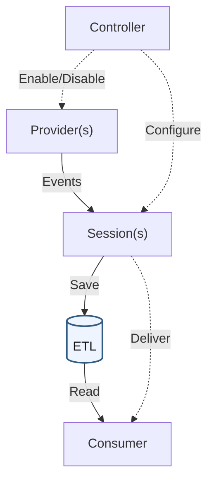

# すばらしきこのETW
ETL(Event Trace Log)の調査方法について

## はじめに

Windowsのログというと一般的にはEVTX形式のイベントログが思い浮かびますが、ETL（Event Trace Log）というログもあったりします（あまり知られていませんが）。

Windowsの診断やアプリケーションのデバッグ、性能の解析などに使われており、プロセスやファイル操作、通信など、システムの細かい動作が記録されることもあるため、Windowsフォレンジックを行う上で有用な情報源のひとつです。

イベントログを調査したことがある人なら分かると思いますが、イベントログには欲しい情報が残っていないことが多いです。  
既定では細かいプロセスの動きやファイル操作、通信までは記録されなかったり、攻撃者によって消されたり、ローテート設定によって直近1〜2時間ぶんしか残っていなかったりはザラ。

一方で、ETLにはイベントログより細かい単位の情報が残っていたり、イベントログは消えていたけどETLは残っていたりもします。

本記事では、ETW/ETLとはなんぞやというところから、実際にETLを読む際のTipsをつらつらと書いていこうかなと。

## 1. ETW概要

### ETWとは

ETW（Event Tracing for Windows）は、OSやアプリケーションが発行するイベントを収集するためのWindowsの **仕組み** です。収集した **結果が保存されたファイルがETL（Event Trace Log）** です。

ETWはWindows 2000で導入され、Windows Vistaで [大幅に拡張されました](https://learn.microsoft.com/en-us/archive/msdn-magazine/2007/april/event-tracing-improve-debugging-and-performance-tuning-with-etw)。
このときWindows Event Logとのイベント発行モデルが統合され、共通の仕組みでイベントを扱えるようになりました。

**本記事では、このWindows Vista以降のETWについて扱います。**

### イベントログとの違い

Windows Event LogとETWは、イベント発行の仕組みの一部を共有しています。違いは、イベントがどのように収集・保存されるかです。

Windows Event Logは[**チャネル**](https://learn.microsoft.com/en-us/windows/win32/wes/defining-channels)に割り当てられたイベントをEVTXとして保存します。一方、ETWは**セッション**にイベントを集め、ETLファイルとして保存したり、リアルタイムに配信したりします。

例えば、発行元のエラーメッセージをイベントログに残し、処理の開始・終了を別のセッションで集めるような構成であれば、EVTXにはエラー、ETLにはその前後の処理が記録として残ります。

同じイベントが両方に残ることもありますが、そのあたりは収集設定次第です。そのため、EVTXにないプロセスの動作やファイル操作、接続先がETLに残る場合があります。

ただし、[Sysmon](https://learn.microsoft.com/en-us/sysinternals/downloads/sysmon)などでEVTXにも詳細な記録を残すことができるため、ETLが常に詳しいというわけでもありません。


### ETWの構成要素

ETWは以下の仕組みからなります。 

| 名前 | 役割 | 例 |
| --- | --- | --- |
| Provider | イベントの発行元 | OSの機能やアプリケーション。`Microsoft-Windows-DNS-Client`など |
| Session | イベントを収集し、ETLや読み取り側へ渡す単位 | 収集対象や出力先を設定して動かすトレースセッション |
| Controller | セッションの開始・停止や、Providerの有効化、収集条件の設定を行う | `logman.exe`、Windows Performance Recorderなど |
| Consumer | イベントを読み取るプログラム | リアルタイムの監視ツールや、取得済みETLの解析ツール |

役割とイベントの流れを簡略化したのが次の図です。実線はイベントの流れ、破線は設定の操作を表します。青枠のETLに保存された内容が本記事で調べる対象です。



まず、Controllerは、セッションの開始・停止と、Providerの有効化・無効化、収集条件の設定を行います。代表的なControllerは`logman.exe`やWindows Performance Recorderなどです。

ControllerがProviderを有効にすると、そのProviderがイベントを発行します。発行されたイベントは、Controllerが指定した条件（重要度を表すLevel、分類を表すKeyword、収集対象のProviderなど）で絞り込まれ、Sessionに集められます。それらのイベントはメモリ上のバッファーに一度集約され、ETLファイルへの書き出しやConsumerへのリアルタイム配信に使われます。

一つのSessionでは、複数のProviderからイベントを収集できます。また、Session自体も複数動かすことができ、同じProviderが発行したイベントが複数のSessionに送られ、それぞれのETLに保存されることもあります。

収集対象や保存方法はSessionごとの設定で決まり、循環記録では古い内容が上書きされます。そのため、ETLを調べる際はファイル名だけでなく、含まれるProviderや記録期間も確認します。

より正確な図はMicrosoftの[ETW Architecture](https://learn.microsoft.com/ja-jp/windows-hardware/test/weg/instrumenting-your-code-with-etw)をご覧ください。

## 2. ETLを保全する

ETLの保存先はアプリケーションの設定などによって異なり、いろんなところに散らばっています。
保全する際は、端末内を検索してコピーしたり、ETLに対応した保全ツールを使うとよいでしょう。

### Live取得する

#### OS標準機能で取得する

Windows標準の[robocopy](https://learn.microsoft.com/en-us/windows-server/administration/windows-commands/robocopy)で、`C:\`以下の`*.etl*`を元の相対パスを保って`E:\Cases\etls`へコピーします。管理者権限で実行しましょう。

```powershell
New-Item -ItemType Directory -Path 'E:\Cases' -Force | Out-Null
robocopy C:\ E:\Cases\etls *.etl* /S /COPY:DAT /DCOPY:DAT /R:0 /W:0 /XJ /UNILOG:E:\Cases\etl-copy.log
```

| オプション | 意味 |
| --- | --- |
| `/COPY:DAT` | データ・属性・時刻のコピー |
| `/DCOPY:DAT` | ディレクトリのデータ・属性・時刻のコピー |
| `/XJ` | ジャンクションの除外 |
| `/R:0` | 再試行しない |

アクセス権やファイル使用中などによるコピー失敗は、`etl-copy.log`で確認します。`/COPY:DAT`にはアクセス権（ACL）や所有者などは含まれないため、この例はETLファイルの一括コピーとして扱います。

コピー後は、ファイルの完全性を検証できるよう、SHA-256などのハッシュ値を記録しておくとよいでしょう。

前述のとおり、イベントは一度セッション上のバッファーに貯められるため、この方法で取得できるのはディスクに書き出された範囲のみとなります。
未出力のバッファーを調べたい場合は、メモリイメージも取得し、[`etw-scan`](https://blogs.jpcert.or.jp/ja/2024/11/etw_forensics.html)というVolatility 3用プラグインを利用する方法もあります。ただし、メモリからすべてのイベントを復元できるとは限りません。

#### 保全ツールで取得する

可能なら保全ツールでまとめて取得するのが理想ですが、ETLに対応したコレクションツールは現状あまり充実していない気がします。

[KAPE](https://github.com/EricZimmerman/KapeDocs)では、定義されたTargetを引数として与えることで関連ファイルをまとめて取得できます。ETL単体ではなく取得元環境やレジストリ登録情報も合わせて取得できるようです。
ただし、KAPEは[商用利用に一定の制限](https://github.com/EricZimmerman/KapeDocs/blob/master/Pages/50-Frequently-asked-questions.md)があるので注意してください。

| Target | 主な取得対象 |
| --- | --- |
| `EventTraceLogs` | WDI、WMI、SleepStudy、Delivery OptimizationなどのETL |
| `WindowsUpdate` | Windows UpdateのETL、`USOShared\Logs\System`以下のETL、CBSログなど |
| `RDPJumplist` | Store版Remote Desktopのパッケージディレクトリ。`LocalState\Logs`も対象に含む |
| `RegistryHivesSystem` | SYSTEM・SOFTWAREなどのシステムハイブとトランザクションログ |

これも実行時は管理者権限で。

```powershell
.\kape.exe --tsource C: --tdest 'E:\Cases\KAPE' --target 'EventTraceLogs,WindowsUpdate,RDPJumplist,RegistryHivesSystem' --tdd false
```

`--tdd false`は、同一内容でも異なるパスのファイルを重複除外せず取得する指定です。
もちろん、これで取得できないETLファイルもあるため、必要であれば設定を追加したり、個別に取得するのがよいでしょう。

また、[Velociraptor](https://triage.velocidex.com/docs/windows.triage.targets/)では、`Windows.Triage.Targets`にKapeFiles由来の収集定義があるようです。私はまだ使っていませんが、慣れている人ならこちらでもよいかもしれません。

### ディスクイメージから取得する

最も確実な方法の一つはやはりディスクイメージですね。
別途取得しておかない限りメモリ上の情報は消えてしまいますが、必要に応じて後から掘り出したりもできるので、対象台数が少ないときにはこちらも検討したいです。

イメージ内からファイルを直接検索して抽出する場合は、[ntfsfind](https://github.com/sumeshi/ntfsfind)と[ntfsdump](https://github.com/sumeshi/ntfsdump)が有用です。

ためしにCFReDSの[Data Leakage Case](https://cfreds-archive.nist.gov/data_leakage_case/data-leakage-case.html)のディスクイメージから`ntfsfind`で`.etl`形式のファイルを検索した結果は以下のとおりです。

```console
> ntfsfind.exe cfreds_2015_data_leakage_pc.E01 -e etl
/Windows/System32/LogFiles/WMI/RtBackup/EtwRTEventlog-Security.etl
/Windows/System32/LogFiles/WMI/RtBackup/EtwRTEventLog-Application.etl
/Windows/System32/wdi/{67144949-5132-4859-8036-a737b43825d8}/{9a3d7e9e-7fc6-43a4-a74e-8d50303fcdae}/snapshot.etl
/Windows/System32/wdi/{67144949-5132-4859-8036-a737b43825d8}/{ac1aa789-a259-4e50-be32-58447f92b714}/snapshot.etl
/Windows/System32/wdi/{86432a0b-3c7d-4ddf-a89c-172faa90485d}/{d3f5594e-34ec-4579-b2ed-9b3aa4a561f9}/snapshot.etl
/Users/informant/AppData/Local/Microsoft/Windows/Explorer/ExplorerStartupLog.etl
/Users/informant/AppData/Local/Microsoft/Windows/Explorer/ExplorerStartupLog_RunOnce.etl
/Windows/System32/LogFiles/WMI/RtBackup/EtwRTUBPM.etl
/Windows/Performance/WinSAT/DataStore/2015-03-24 11.11.25.240.winsat.etl
/Windows/System32/wdi/{86432a0b-3c7d-4ddf-a89c-172faa90485d}/{8c8a5498-1428-4a4f-9a52-aa2105754f70}/snapshot.etl
/Windows/System32/wdi/{86432a0b-3c7d-4ddf-a89c-172faa90485d}/{9e840662-7805-40ea-abbc-2666b58e80f3}/snapshot.etl
/Windows/System32/umstartup.etl
/Windows/System32/umstartup000.etl
/Windows/System32/LogFiles/WMI/Terminal-Services-Core.etl
/Windows/System32/LogFiles/WMI/Terminal-Services-IP-Virtualization.etl
/Windows/System32/LogFiles/WMI/Terminal-Services-RPC-Client.etl
/Windows/System32/LogFiles/WMI/Terminal-Services-SessionEnv.etl
/Windows/System32/LogFiles/WMI/Terminal-Services-Unified-APIs.etl
/Windows/System32/LogFiles/WMI/RtBackup/EtwRTDiagLog.etl
/Windows/System32/LogFiles/WMI/RtBackup/EtwRTEventLog-System.etl
/Windows/System32/wdi/LogFiles/BootCKCL.etl
/Windows/System32/wdi/LogFiles/ShutdownCKCL.etl
/Windows/System32/wfp/wfpdiag.etl
/Windows/System32/wdi/{86432a0b-3c7d-4ddf-a89c-172faa90485d}/{dc425e1a-3399-4a2e-9a96-e67a64c9ffd2}/snapshot.etl
/Windows/System32/wdi/{86432a0b-3c7d-4ddf-a89c-172faa90485d}/{3aaf5c18-c3df-412f-921f-a7c03ea7e145}/snapshot.etl
/Windows/System32/wdi/{86432a0b-3c7d-4ddf-a89c-172faa90485d}/{336c8a0e-f419-4df4-b3fe-52de057e5cae}/snapshot.etl
/Windows/Panther/setup.etl
/Windows/System32/winevt/Logs/DebugChannel.etl
/Windows/System32/winevt/Logs/Microsoft-RMS-MSIPC%4Debug.etl
/Users/admin11/AppData/Local/Microsoft/Windows/Explorer/ExplorerStartupLog.etl
/Users/temporary/AppData/Local/Microsoft/Windows/Explorer/ExplorerStartupLog.etl
/ProgramData/Microsoft/Windows/Power Efficiency Diagnostics/energy-trace.etl
/ProgramData/Microsoft/Windows/Power Efficiency Diagnostics/energy-ntkl.etl
/Windows/System32/wdi/{86432a0b-3c7d-4ddf-a89c-172faa90485d}/{2c5f5048-4e9b-487e-b245-7e0e9b604606}/snapshot.etl
/Windows/System32/LogFiles/WMI/RtBackup/EtwRTMsMpPsSession7.etl
```

結構いっぱいありますね。抽出する場合は次のようにパイプで`ntfsdump`に渡してあげます。

```console
> ntfsfind.exe cfreds_2015_data_leakage_pc.E01 -e etl | ntfsdump.exe cfreds_2015_data_leakage_pc.E01 -o etl
```

その他詳しい方法については [NTFS脊髄剣](https://sumeshi.github.io/posts/works/ntfsfind-dump) を参照。

https://sumeshi.github.io/posts/works/ntfsfind-dump

### 一緒に残しておくとよい情報

証拠性を担保するためには、取得したログをどの機器から、どのような方法で取得したのかを記録しておく必要があります。
実用上の話としても、環境情報などを残しておくことでいちいち調べ直す手間を減らせます。

少なくとも以下はあったほうがよいでしょう。

| 情報 | 用途 |
| --- | --- |
| 取得元のコンピュータ名、ユーザー、元のパス、取得日時、ツールや方法 | 複数端末や複数ユーザーのログを区別し、どこから取り出したものかを確認する |
| Windowsのビルド・アーキテクチャ、関連アプリのバージョン | 別の解析端末で内容を読めないときに、取得元との違いを確認する（最悪レジストリからも調べられますが） |
| タイムゾーン | ローカル時刻で表示されるログを、ほかの端末やUTCの記録と照合して補正する |
| 対象Providerの定義を含むファイル | 解析端末に定義がない場合に、イベントの項目名や値を読み取る |
| ファイルのハッシュ | コピーや受け渡しの前後で、同じファイルを扱っているか確認する |

```powershell
Get-CimInstance Win32_OperatingSystem |
    Select-Object Caption, Version, BuildNumber, OSArchitecture |
    Export-Clixml -LiteralPath 'E:\Cases\os.xml'

Get-TimeZone | Export-Clixml -LiteralPath 'E:\Cases\timezone.xml'
Get-Date -Format o | Out-File -FilePath 'E:\Cases\collection-time.txt'
```

Live取得の場合は、[logman query](https://learn.microsoft.com/en-us/windows-server/administration/windows-commands/logman-query)で現在のセッションやProviderも記録できるので活用しましょう。

```powershell
logman query -ets | Out-File -FilePath 'E:\Cases\sessions.txt'
logman query 'SessionName' -ets | Out-File -FilePath 'E:\Cases\session-details.txt'
logman query providers | Out-File -FilePath 'E:\Cases\providers.txt'
```

当然ですが、この一覧は取得時点の状態です。過去の設定や定義は消えてしまっている場合があります。
可能なら`.man`や定義を含むDLL・EXEも取得できるとよいのですが、初動でそれをやるのは現実的に難しいかもしれません。詳細は後述。

## 3. ETLを変換する

ETLは別のPCに持ち込んでも読み取ることができますが、アプリケーションやProviderの定義がない、バージョンが合わないなど、イベントを解釈するための定義が欠落していると正しくパースできません。
取得元と同じ環境でパースしたり、定義を含むファイルを保全しておいたりすることで、読める情報が増える場合もあります。

### イベントメタデータの方式

ペイロード（イベント固有項目）部分は、定義がないと項目名や型を正しく解釈できません。詳細は[Event Metadata Overview](https://learn.microsoft.com/en-us/windows/win32/etw/event-metadata-overview)を参照。

代表的な方式は次のとおりです。

| 方式 | 定義の持ち方 | 解釈に必要なもの |
| --- | --- | --- |
| Manifest-based | イベントの種類・項目をManifestであらかじめ定義する | 対応する`.man`、または定義を含むDLL・EXEなど |
| TraceLogging | 項目名や型などの定義をイベントに含める | その自己記述形式に対応したツール。個別のManifestを必要としない |
| MOF / Classic | MOF（`.mof`）という定義を使う従来方式 | 登録されたMOFスキーマや、そのイベントを解釈できるツール内の定義 |
| WPP | デバッグ用のトレースメッセージを、外部の書式情報で読み取る | 対応するPDB（デバッグ情報ファイル）、またはそこから取り出したTMFと、WPP対応ツール |

定義の欠落だけでなく、ツールが未対応の場合もあるので、うまくいかないときはまずそこを切り分けるとよいでしょう。

### OS標準機能で変換する

`tracerpt`や`Get-WinEvent`を使うことで内容を確認できます。
人間様が確認しやすいのはCSVですが、項目名やデータ構造を詳しく調べたい場合はXMLも使えます。

```powershell
tracerpt 'C:\Cases\trace.etl' -o 'C:\Cases\trace.csv' -of CSV

Get-WinEvent -Path 'C:\Cases\trace.etl' -Oldest -MaxEvents 5 |
    ForEach-Object { $_.ToXml() }
```

得られるのはこんな感じの情報です。

| Event Name | Type | Event ID | Version | Channel | Level | Opcode | Task | Keyword | PID | TID | Processor Number | Instance ID | Parent Instance ID | Activity ID | Related Activity ID | Clock-Time | Kernel(ms) | User(ms) | User Data |
| --- | --- | --- | --- | --- | --- | --- | --- | --- | --- | --- | --- | --- | --- | --- | --- | --- | --- | --- | --- |
| Microsoft-Windows-Shell-Core | Start | 9601 | 0 | 16 | 4 | 1 | 9601 | 0x0000000004010000 | 0x000005A8 | 0x00000594 | 0 | | | {00000000-0000-0000-0000-000000000000} | | 1.30715084822146E+017 | 0 | 0 | DataSize=0 |
| Microsoft-Windows-Shell-Core | Start | 9703 | 0 | 16 | 4 | 1 | 9703 | 0x0000000004010000 | 0x000005A8 | 0x00000594 | 0 | | | {00000000-0000-0000-0000-000000000000} | | 1.30715084826663E+017 | 0 | 0 | DataSize=0 |
| Microsoft-Windows-Shell-Core | Stop | 9704 | 0 | 16 | 4 | 2 | 9703 | 0x0000000004010000 | 0x000005A8 | 0x00000594 | 0 | | | {00000000-0000-0000-0000-000000000000} | | 1.30715084834634E+017 | 0 | 0 | DataSize=0 |
| Microsoft-Windows-Shell-Core | Start | 9707 | 0 | 16 | 4 | 1 | 9707 | 0x0000000004010000 | 0x000005A8 | 0x00000594 | 0 | | | {00000000-0000-0000-0000-000000000000} | | 1.30715084836727E+017 | 0 | 0 | C:\Windows\SysWOW64\ie4uinit.exe -BaseSettings |

詳細は[tracerpt](https://learn.microsoft.com/en-us/windows-server/administration/windows-commands/tracerpt)と[Get-WinEvent](https://learn.microsoft.com/en-us/powershell/module/microsoft.powershell.diagnostics/get-winevent?view=powershell-5.1)を参照。

ETLを別のPCへ持っていくと、取得元にしかないProviderの定義が必要になる場合があります。取得元の環境を利用できるのであれば、`wevtutil gp`で登録されている関連ファイルを確認できます。

```powershell
wevtutil gp 'Microsoft-Windows-DNS-Client' /f:xml
```

`resourceFileName`や`messageFileName`に示されたDLL・EXEや、SOFTWAREハイブの`Microsoft\Windows\CurrentVersion\WINEVT\Publishers`を手掛かりに探します。

また、元の定義を用意できたとしても、ツールがその方式に対応していなければ読み取れません。どうしても読めなければ、バイナリを直接調べたり、AIにぶん投げてみたりするのも手かもしれません。

### ETW2JSONで変換する

複数ファイルを横断して検索・集計したい場合は、統一したフォーマットへ変換するのが便利です。
Microsoftの[ETW2JSON](https://github.com/microsoft/ETW2JSON)を使うと、次のようにJSONに変換できます。

```powershell
ETW2JSON 'C:\Cases\trace.etl' '--output=C:\Cases\trace.json'
```

ただし、取得元から持ち帰ったManifestやDLLを直接指定できない、読み取れなかったイベントの元データや使用した定義を確認しにくい ~~、exeが配られていなくていちいちコンパイルするのが面倒~~ などの課題があったため、フォークして改良しました。

https://github.com/sumeshi/ETW2JSON

**主な変更点**

- ローカルの定義を使用するかどうかを`--allow-local-metadata`で選択可能にし、使用した定義元も記録するよう変更。
- 外部のイベント定義として`--manifest`、`--resource`、`--provider-info`を追加し、ManifestやDLLなどを指定可能に変更。
- デコードできない場合にも、元のイベントID・バージョン・生データ・デコード状態を保持するよう変更。
- 事前調査用に`--scan`や`--report-missing`を追加し、不足するメタデータを確認可能に変更。
- JSONL出力を追加。
- 既存ファイルの上書き防止機能を追加。

上記のとおり、既定では解析PCに登録されたメタデータを使用しないため、とりあえず中身を見たいときには`--allow-local-metadata`を指定して変換できます。
ただし、取得元と解析PCで定義が異なる可能性がある点には注意してください。

```powershell
ETW2JSON.exe 'C:\Cases\ExplorerStartupLog.etl' `
    --allow-local-metadata `
    --output 'C:\Cases\ExplorerStartupLog.jsonl'
```

出力はこんな感じです。

```json
{
  "timestamp": "10031861934",
  "raw_timestamp": 10031861934,
  "trace_clock": {
    "performance_frequency": 10000000,
    "start_time": 130715084822135124,
    "boot_time": 130715074949265519,
    "reserved_flags": 1
  },
  "provider_guid": "30336ed4-e327-447c-9de0-51b652c86108",
  "provider_name": "Microsoft-Windows-Shell-Core",
  "event_id": 9707,
  "version": 0,
  "level": 4,
  "opcode": 1,
  "task": 9707,
  "keyword": 9223372036921950208,
  "process_id": 1448,
  "thread_id": 1428,
  "processor_number": 0,
  "activity_id": null,
  "related_activity_id": null,
  "event_name": "Microsoft-Windows-Shell-Core/Explorer_ExecutingFromRunKey/Start",
  "properties": {
    "Command": "C:\\Windows\\SysWOW64\\ie4uinit.exe -BaseSettings"
  },
  "metadata_source": "local_cache",
  "decode_status": "decoded",
  "metadata_provenance": "tdh:analysis-host-provider-registration",
  "raw_payload": "QwA6AFwAVwBpAG4AZABvAHcAcwBcAFMAeQBzAFcATwBXADYANABcAGkAZQA0AHUAaQBuAGkAdAAuAGUAeABlACAALQBCAGEAcwBlAFMAZQB0AHQAaQBuAGcAcwAAAA==",
  "source_file": "ExplorerStartupLog.etl"
}
```

なお、`timestamp`はUTC日時ではなく生のETWタイムスタンプです。別のログと時刻を照合する際は、トレースの時計情報を基に日時へ変換する必要があります。

`--resource`でDLLやEXEを指定できます。読み取りに使うだけなので実行はされません。

```powershell
ETW2JSON.exe 'C:\Cases\trace.etl' `
    --resource 'C:\Cases\Metadata\provider.dll' `
    --output 'C:\Cases\trace-with-metadata.jsonl'
```

`.man`を指定する場合は`--manifest`を使います。

読み取りできたかは`decode_status`で確認できます。

- `decoded`：読み取り成功
- `metadata_missing`：定義不足
- `unsupported`：ツール側の未対応

うまくいかない場合は`--report-missing`を使って、不足している定義を洗い出すとよいでしょう。

### 用途に特化したツールを使う

Windows Updateなどのよく使われるログであれば、それに特化したツールやコマンドを探して使うのが丸い。

| 対象 | ツール |
| --- | --- |
| Windows Update | `Get-WindowsUpdateLog` |
| Delivery Optimization | `Get-DeliveryOptimizationLog`、`Get-DeliveryOptimizationLogAnalysis` |
| CPU・ディスクI/Oなど | WPA、PerfView |
| WPP | Tracefmt |
| パケットを含むETL | [Microsoft etl2pcapng](https://github.com/microsoft/etl2pcapng) |

次の2つはMicrosoft製のGUIツールとして有名です。

| 名称 | 機能 |
| --- | --- |
| [PerfView](https://github.com/microsoft/perfview) | 収録期間・イベント数・ロスト数を確認し、種類やプロセスで絞ることが可能 |
| [Windows Performance Analyzer（WPA）](https://learn.microsoft.com/ja-jp/windows-hardware/test/wpt/windows-performance-analyzer) | Provider、時刻、各イベントの項目で絞り込み、CPU・I/Oなどの情報と合わせてグラフ表示などが可能 |


イベントのグラフ表示など、詳細な情報を確認できます。ただし、主な用途はデバッグやパフォーマンスチューニングのような気がします。以下の記事が詳しいです。

[PerfView / Windows Performance Analyzer (WPA) の使い方](https://qiita.com/kouzimiso/items/a74466f8fc2032683845)

### Linuxで解析したい場合

[Airbus CERT etl-parser](https://github.com/airbus-cert/etl-parser)や[Dissect](https://docs.dissect.tools/en/stable/projects/dissect.etl/index.html)などの、Windows以外でも利用できるツールを使うとよいでしょう。

`etl-parser`は現在もメンテナンスされており、非常に有用です。以下のようにXML形式に変換できます。

```bash
etl2xml -i example.etl -o example.xml
```

Dissectは有名なOSSのフォレンジックフレームワークです。[ETL関連のプラグイン](https://docs.dissect.tools/en/stable/plugins/etl.etl.html)があるので、用途に応じて使えます。

```bash
target-query 'case.E01' -f etl.boot,etl.shutdown -j > etl-events.jsonl
```

ディスクイメージからBoot・ShutdownのETLをまとめて出力する場合は、上記のように実行します。

## 4. 情報をまとめる

概念の理解と変換のコツさえ押さえれば、あとはイベントログの調査と同じです。

ログによって記録されている項目は大きく異なるので、時間という共通する一つの軸で情報を整理し、仮説と検証を繰り返しながらまとめていきます。

知識とひらめき。あとはひたすら根気の作業ですね。

Windowsイベントログの調査については、以前公開した[こちらの記事](https://sumeshi.github.io/posts/knowledges/windows-eventlog-analysis-101)も参考にしてください。

https://sumeshi.github.io/posts/knowledges/windows-eventlog-analysis-101


## Appendix. ETL調査のヒント

前述のとおり、ETLはいろんなところに散らばっているので、何を調べたいときにはどこを見るか、というのを備忘としてまとめておきます。

ただし、ETLはまだ謎が多く、対象システムの構成や設定によってもかなり違いがありそうなので、ノウハウを一般化するにはまだ時間がかかりそうです。

今後自分で検証できたことも追記予定。

| 調査項目 | 保存先 |
| --- | --- |
| プログラムの実行 | `%ProgramData%\Microsoft\Diagnosis\ETLLogs\AutoLogger\AutoLogger-Diagtrack-Listener.etl` |
| システム起動・終了時のファイル操作など | `%SystemRoot%\System32\WDI\LogFiles\` |
| 記録時点のディスク構成 | `%ProgramData%\Microsoft\Windows\Power Efficiency Diagnostics\energy-ntkl.etl` |
| Explorerが扱ったパス・Runキー | `%LOCALAPPDATA%\Microsoft\Windows\Explorer\ExplorerStartupLog.etl` |
| 旧Store版Remote Desktop | `%LOCALAPPDATA%\Packages\Microsoft.RemoteDesktop_8wekyb3d8bbwe\LocalState\Logs\` |
| Wi-Fi | `%SystemRoot%\System32\LogFiles\WMI\Wifi.etl` |
| 外部IPアドレスなど | `%SystemRoot%\ServiceProfiles\NetworkService\AppData\Local\Microsoft\Windows\DeliveryOptimization\Logs\` |
| Windows Update | `%SystemRoot%\Logs\WindowsUpdate\`、`%ProgramData%\USOShared\Logs\` |

### プログラムの実行

[Uncovering Hidden Forensic Evidence in Windows: The Mystery of AutoLogger-Diagtrack-Listener.etl](https://www.fortinet.com/blog/threat-research/uncovering-hidden-forensic-evidence-in-windows-mystery-of-autologger)によると、Windows Server 2016の`AutoLogger-Diagtrack-Listener.etl`から、削除された実行ファイルのパスとコマンドラインが見つかったとのことです。

ただし、同ファイルがどのような条件下で書き込まれるのかは依然として不明とのことです。

### 起動・終了時のファイル操作など

`BootCKCL.etl`や`ShutdownCKCL.etl`には、システム起動・終了時のファイル操作やプロセスの動き、DLLのロードが残る場合があります。

`FileIo/FileCreate`、`FileIo/FileDelete`、`Process/Start`、`Process/End`など、興味深いイベントが記録されている場合があります。ただし、`FileIo/FileCreate`はファイルの新規作成を単独で証明するものではありません。イベント名だけで操作の成否を判断せず、関連するイベントやほかのアーティファクトと照合する必要があります。

[ETW Event Tracing for Windows and ETL Files](https://www.hecfblog.com/2018/06/etw-event-tracing-for-windows-and-etl.html)では、実際に不審な実行ファイルに関する情報を追跡する過程が解説されています。

### ディスクやボリュームの構成

`energy-ntkl.etl`には、記録時点のディスクやデバイスの情報が含まれる場合があります。`SystemConfig/PhyDisk`、`SystemConfig/LogDisk`、`SystemConfig/PnP`など、ディスクの詳細を知りたいときに有用そうです。レジストリなどと突き合わせて確認するとよいでしょう。

参考：[ETW Event Tracing for Windows and ETL Files](https://www.hecfblog.com/2018/06/etw-event-tracing-for-windows-and-etl.html)

### Explorerが扱ったパスやRunキー

`ExplorerStartupLog.etl`には、Explorerが扱ったパスや共有先、Runキーに関するイベントが含まれる場合があります。

[etw-providers-docs](https://github.com/repnz/etw-providers-docs)にはProviderに関する定義がまとめられており、次のようなイベントが確認できます。

| Event ID | 項目 |
| --- | --- |
| 9705 / 9706 | Runキーの列挙。`KeyName`を確認する |
| 9707 / 9708 | Runキーからの起動処理。`Command`や`PID`を確認する |
| 19501 / 19502 | パスの解析。`Name`や結果を確認する |

これに限ったことではありませんが、LNK、Jump List、ShellBagsなど、ほかの痕跡とも突き合わせて確認しましょう。

### Remote Desktop接続

[Remote Desktop Application vs MSTSC Forensics: The RDP Artifacts You Might Be Missing](https://www.zerofox.com/blog/remote-desktop-application-vs-mstsc-forensics-the-rdp-artifacts-you-might-be-missing/)では、旧Store版Remote DesktopのETLから、接続先やユーザー名、ログイン完了・切断に関する情報が確認できたとのことです。

また、関連する`.model`ファイルには、保存された資格情報を特定するための情報が含まれる場合もあるとのことです。

### Wi-Fi接続

`Wifi.etl`には無線接続のイベントが残る場合があります。ただし、SSIDが見つかったからといって接続に成功したとは限りません。関連するイベントを読み、認証中、接続済み、切断など、どの段階まで進んだのかを確認しましょう。

参考：[Advanced troubleshooting wireless network connectivity](https://learn.microsoft.com/en-us/troubleshoot/windows-client/networking/wireless-network-connectivity-issues-troubleshooting)

### 外部IPアドレス

Windows Updateなどのコンテンツ配信に利用されるDelivery Optimization（DoSvc）のETLから、外部IPアドレスを調べられる場合があります。

[What was my IP? Ask DoSvc on Windows 10](https://forensenellanebbia.blogspot.com/2018/12/what-was-my-ip-ask-dosvc-on-windows-10.html)によると、`ExternalIpAddress`というキーワードから、VPN利用時のIPアドレスなどを確認できたとのことです。

Windows 10 2004以降であれば、`Get-DeliveryOptimizationLogAnalysis`コマンドで接続先・ピア種別・転送量などを確認できます。

```powershell
Get-DeliveryOptimizationLogAnalysis 'C:\Cases\DeliveryOptimization\trace.etl' `
    -ListConnections
```

### Windows Update

`Get-WindowsUpdateLog`コマンドを使うことで、Windows Updateに関する情報を取得できます。

```powershell
Get-WindowsUpdateLog -ETLPath 'C:\Cases\WindowsUpdate' `
    -LogPath 'C:\Cases\WindowsUpdate.log'
```

更新GUIDから前後の処理を追っていきます。例えば`ProtocolTalker`は更新サーバーとのやり取り、`DownloadManager`はダウンロード、`Handler`や`Setup`はインストール関連の処理です。

`UpdateSessionOrchestration.etl`には更新や再起動の調整、`NotificationUxBroker.etl`には通知に関するログが含まれています。

## おわりに

ETLにはイベントログに記録されない有用な情報が残っていることがあります。しかし、環境によって得られる情報にかなり差があるためイベントログ以上の魔境感がありますね。

私も情報を取捨選択できるほどノウハウが貯まっているわけではないので、とりあえず全部取って分析！くらいの勢いでやったほうがいいのかもと思っています。あるいはLLMに投げる前提でやるか。

おしまい
