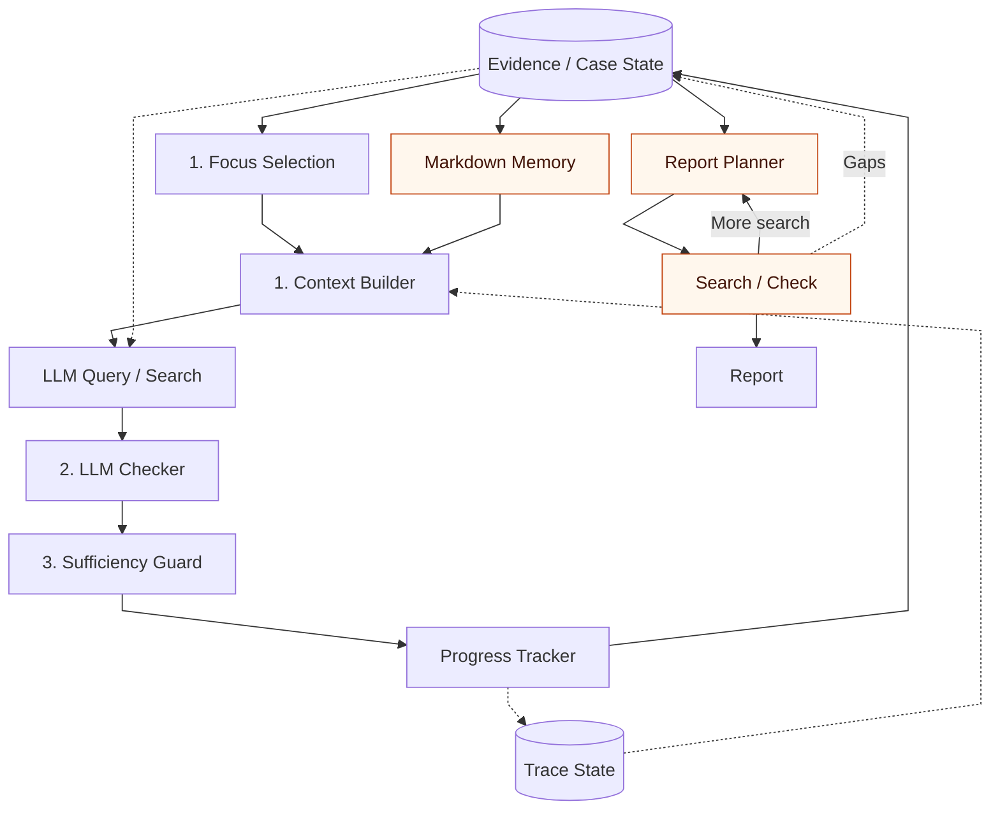
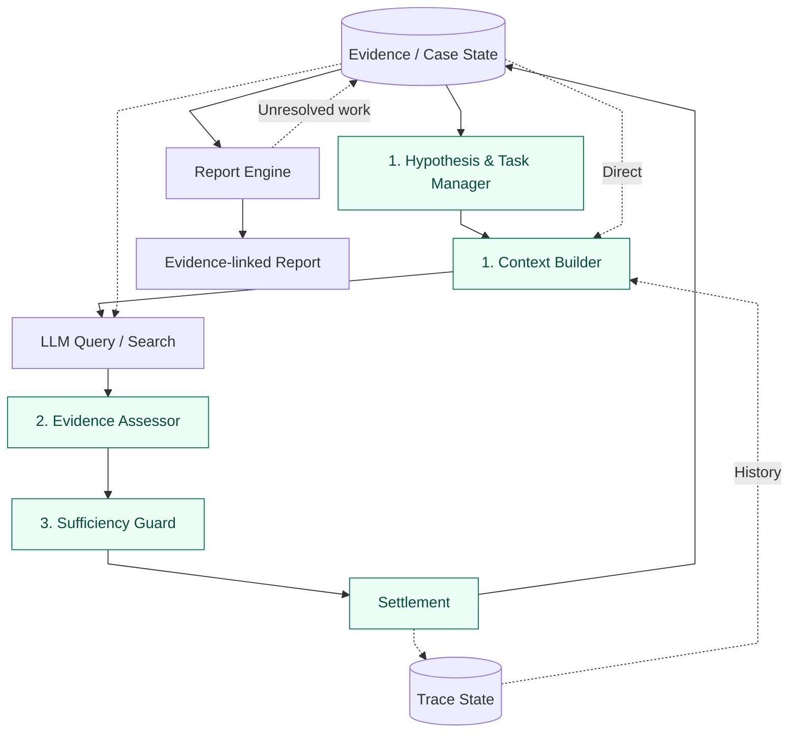

# Do Local LLMs Dream of Forensic Investigators? — Part II

How I improved the investigation loop in my digital forensics harness, FORENSIA, taking inspiration from ARTEX.

## Introduction

I've been developing a digital forensics harness called [FORENSIA](https://github.com/sumeshi/forensia).

https://github.com/sumeshi/forensia

The idea is to ingest Windows artifacts, use a local LLM to autonomously formulate investigative hypotheses, verify them against evidence, and put the results together in a report.

Why did I want to build this? Mostly because I wanted to reduce, even a little, the cost that attackers impose on defenders.

Digital forensics is hard work as it is. Generative AI is making attacks easier, and the burden on defenders is only growing. Of course, defenders will have to make use of AI as well, or we'll never keep up.

Since September 2026, there has been a steady stream of disclosures about cyberattack damage around the world. Seeing what's happening, I feel that using AI for defense deserves much higher priority.

Meanwhile, in Japan, discussions about AI adoption still tend to revolve around digital transformation (DX) or AI transformation (AX). When it comes to preparing for attacks, we're quite a few laps behind.

To figure out what we should be doing in this situation, we need to know what's happening on the RED side, too.

Recently, [ARTEX](https://github.com/Autumn-27), an autonomous penetration-testing harness, attracted a lot of attention. Apparently, it won an AI offense-and-defense competition held in Chengdu, China. After it was released as open source, countless forks appeared. I imagine that lowered the barrier to launching attacks to some extent (whether it is actually being used in the attacks we're seeing today is another matter).

That wasn't the outcome its developers wanted, and the original repository is now private. Still, I found ARTEX's architecture quite elegant, with ideas that could apply to AI harnesses in general.

In this article, I'll share what I learned while bringing some of ARTEX's ideas into FORENSIA.

> *For more background on why I built FORENSIA, see my [previous article](https://sumeshi.github.io/posts/works/do-localllms-dream-of-forensic-investigator-en). Note that it describes the state of the project around May–July 2026, so some details may no longer reflect the current version.*

https://sumeshi.github.io/posts/works/do-localllms-dream-of-forensic-investigator-en

## Design Principles

In LLM development, the focus has expanded from Prompt Engineering to Context Engineering, Harness Engineering, and Loop Engineering.

Part of that is because LLMs themselves have become more capable. But I also think it's because LLMs have made development ridiculously fast. The faster we can generate code, try it out, and rewrite it, the more important it becomes to design how those pieces fit together, rather than focusing on individual implementations.

AI harnesses are particularly closely tied to LLMs, so I'd like to build architectures that last and can keep up with evolving models. To borrow an analogy from the **Pyramid of Pain**, it's about looking past individual components that change quickly and focusing on the underlying structure that changes less. Something like that.

With FORENSIA, I've also been paying close attention to the responsibilities of planning, execution, state management, verification, and reporting, and how they connect. The goal is **to be able to replace individual parts as models and tools change, without rebuilding the entire system**.

With that in mind, FORENSIA follows three design principles.

### 1. Fight Alone

I want to be able to investigate without sending sensitive evidence outside, even in a completely isolated environment. Evidence storage, search, investigation state management, and LLM inference are all designed to **run entirely locally**.

[FORENSIA: Local LLM Forensic Harness](https://speakerdeck.com/sumeshi/forensia-local-llm-forensic-harness?slide=3)

Of course, managed LLM services are an option, too. But for digital forensics, I think being able to keep everything on your own machine is best.

And who knows how long we'll be able to get hold of models so easily or use inference so cheaply? I'd like to keep the option of running things locally, without depending on any particular service.

### 2. Don't Expect Too Much from the LLM

I leave things that are difficult to handle with deterministic code—generating hypotheses, proposing verification strategies, interpreting evidence, and so on—to the LLM. Meanwhile, the harness handles evidence queries, operation restrictions, verification conditions, and investigation state updates mechanically wherever possible.

Even so, it's tough to leave everything from investigation planning to final conclusions to a small model that can run comfortably on local hardware. No matter how much the models improve or how much we learn about running them, we still have to assume they'll make mistakes and forget what they were doing.

What I want from a local LLM is simple: **give it the information and instructions it needs, and have it actually do what it's told**. Sure, you can brute-force your way to better results with a more powerful model, but I think we should also look for ways not to depend on that.

Incidentally, I've found [Ornith-1.5-9B](https://huggingface.co/ornith-ai/Ornith-1.5-9B) remarkably capable for its parameter count. Despite being a small 9B model, it runs smoothly, and even during long runs it seems less prone to repeating the same reasoning or wandering off into endless tangents. In that sense, I think it's a very capable agent model.

The harness's job is to keep the whole investigation more or less on track, while accounting for the limitations of small models like this.

> *If you're wondering why I insist on small models, I wrote about that in [Don't Make AI Your Forensic Analyst](https://sumeshi.github.io/posts/works/dont-make-ai-your-forensic-analyst-en).*

https://sumeshi.github.io/posts/works/dont-make-ai-your-forensic-analyst-en

### 3. Spend Time Like Water

**There's no need to get the right answer in a single inference.** That's difficult even for humans.

I don't want to throw every log and artifact at a model and ask it to investigate everything in one go. Instead, it starts from an observation, forms a hypothesis, examines the evidence, considers alternatives, and gradually moves the investigation forward.

It records what it investigated, what it learned, and where it failed, and uses that information in subsequent work. But having time to spare doesn't mean repeating the same failure indefinitely. Progress, whether the work is actually verifiable, and execution budgets determine when an investigation should continue or stop.

## Why I Revisited the Design

The original FORENSIA was designed with coding agents in mind, especially [Pi Coding Agent](https://github.com/earendil-works/pi). Coding and investigation are different things, but they share a loop: obtain information, perform an action, and decide what to do next based on the result.

Even then, I was trying to work out how to let it run for long periods without a human having to give instructions at every step.

A loop that verifies individual hypotheses can't manage an entire investigation on its own. Which hypothesis should be examined first? When should a stalled task be put aside? Where should the investigation resume when new evidence arrives? Those decisions have to be made separately from whether a particular query succeeds.

## ARTEX's Architecture

ARTEX is a harness for carrying out penetration tests autonomously with an LLM. It consists of a Go backend, a Next.js web UI, PostgreSQL, and other components. At its core are two agent roles: Planner and Worker.

The Planner keeps track of the overall investigation and decides what should happen next. Workers take individual tasks, called Intents, assigned by the Planner and use tools to gather information.

ARTEX uses two graphs to track the progress of this work.

The Asset Graph manages targets such as domains, IP addresses, and services. The Exploration Graph manages the relationships among goals (Goal), tasks (Intent), facts (Fact), and findings (Finding).

In broad strokes, the Planner reads the current state from the Exploration Graph and issues the next Intent. A Worker executes it and saves what it finds back to the graphs. That change wakes the Planner again, and the cycle repeats.

The Planner also maintains a shared Todo list across its runs, issuing new Intents according to task dependencies. Workers' execution traces are recorded as well, so later tasks can use not just the final findings but also information about what was tried along the way.

Rather than planning everything up front, the Planner reconsiders what to do next as Workers return results. This makes sense for digital forensics, too. You can't lay out every investigative step in advance; you have to find evidence and then decide what to investigate next. Automating that kind of judgment was one of the harder problems before LLMs came along.

What I took from ARTEX for FORENSIA was **the separation between managing the overall work and executing individual tasks, with the results fed back into the next round of planning**.

More specifically, the Hypothesis & Task Manager selects the next task, the Context Builder prepares the information needed for it, and the verification results are saved to Case State and Trace State so they can inform subsequent task selection.

## Before and After

Earlier versions of FORENSIA already had a mechanism for prioritizing hypotheses, but overall task management was still limited. The investigation largely proceeded by selecting candidate hypotheses and examining them one after another.

Part of the investigation state was also projected into Markdown memory documents and passed on as context for subsequent work. (One reason for this was to make it easier for humans to follow the investigation process.)

And because verifying hypotheses alone doesn't necessarily produce everything a report needs, the reporting side had its own independent LLM-based planning, search, and checking loop.

Fig. 1. Simplified architecture before the changes. The orange-highlighted components were removed in this revision.

In revisiting this design, I took inspiration from ARTEX to clarify the relationship between overall task management and individual verification work. The rules for selecting, deferring, and resuming tasks are now more consistent, and verification results are carried forward into subsequent decisions.

I also changed the Context Builder to assemble context directly from the database, without an intermediate Markdown memory document. The reporting side's independent exploration loop has been folded into the investigation side.

Evidence evaluation has been reorganized as well, separating the question of whether an individual piece of evidence satisfies the verification conditions from whether that evidence is sufficient to draw a conclusion.

Fig. 2. Simplified current architecture. Green highlights indicate the main changes.

No. 1 shows the task management and state handoff inspired by ARTEX. Nos. 2 (Evidence Assessor) and 3 (Sufficiency Guard) are the changes aimed at the evidence verification and sound conclusions required in digital forensics.

Below, I'll look at these three areas: selecting tasks and carrying state forward, checking whether evidence meets verification conditions, and deciding whether the evidence is sufficient for a conclusion.

### 1. Selecting Tasks and Carrying State Forward

To sustain a long investigation, it's not enough to decide what to examine next. The system also needs to carry forward what has already been investigated and what has been learned.

I revised the Hypothesis & Task Manager so it takes more than just hypothesis priority into account. It considers the required evidence, task dependencies, and previous attempts when selecting the next task. Work that can't proceed is deferred with a reason and conditions for resumption, rather than letting the system repeat the same failure.

Another important component is the Context Builder.

Investigation state is saved as Case State, while the history of queries and decisions is saved as Trace State. But I don't feed all of it to the LLM. The Context Builder picks out the current hypothesis, related evidence, unmet conditions, unresolved work, and past attempts, assembling them into a Working State. It also provides relevant schemas and query methods for the task.

Previously, Markdown acted as temporary memory for this information. That made it easier to organize what the model would see and allowed humans to inspect the investigation as it progressed. But once I started managing work based on the state of the whole investigation, it made more sense to build the context directly from the database each time rather than going through a memory document.

By this point, the basic mechanisms had come together and FORENSIA was at least somewhat usable for investigations, so I switched to constructing Working State directly from Case State and Trace State.

The Hypothesis & Task Manager decides **what to do next**, and the Context Builder decides **what the model needs to see to do it**. Rather than expecting the model to remember the entire investigation, the harness supplies **only the information it needs**.

### 2. Checking Whether Evidence Meets the Verification Conditions

Previously, search results were passed to an LLM, which proposed whether they supported a hypothesis. There were verification steps after that, of course, but the evaluation of individual evidence still depended heavily on the model.

The Evidence Assessor is where I reorganized that responsibility.

Finding information in search results is not the same as finding evidence that supports a hypothesis. Even if an LLM says, "Here's the evidence," the record might refer to the wrong target or fail to meet the condition we wanted to check.

The Evidence Assessor evaluates evidence against previously saved verification conditions. Instead of treating the model's explanation or SQL-derived values as authoritative, it retrieves the normalized records again by Evidence ID and checks them directly.

Checks that can be expressed using a particular field and comparison condition are handled in code as typed observations. For those checks, even the query construction and condition matching can sometimes be completed without involving the LLM.

The idea is to have the LLM decide what to investigate, while **code checks whether the evidence actually matches the conditions**, wherever possible. It's an attempt to reduce hallucinations from small models.

### 3. Checking Whether the Evidence Is Enough for a Conclusion

Even when evidence meets the verification conditions, it may not provide enough support for a conclusion. The Sufficiency Guard takes the results of individual evidence assessments and considers whether there is enough support to accept the conclusion.

This mechanism existed in earlier versions, but I clarified its responsibilities relative to the Evidence Assessor and reorganized the checks around factors such as evidence independence and the scope of what can actually be observed.

Finding the same evidence through multiple searches doesn't increase its evidentiary weight. And even if records are separate, they aren't counted as independent evidence if they were derived from the same source.

Likewise, a query returning zero rows doesn't prove an activity never happened when the necessary logs weren't collected. FORENSIA tracks the available evidence and what it can reveal as Coverage. The final Settlement stage checks whether an empty query result can legitimately be used to refute a hypothesis.

After these evaluations, Settlement finalizes the verdict. If the evidence is insufficient, the question remains unresolved rather than being forced into a conclusion.

**Evidence meeting a verification condition and that evidence being sufficient to draw a conclusion are two different things.** By separating those stages, the harness decides whether the model's proposed conclusion can be accepted as an investigation result.

## Evaluation

What I expect from these changes isn't simply higher answer accuracy, but better consistency throughout long-running investigations.

By improving task management and the Context Builder, I hope to reduce repeated queries and cases where the system loses sight of the investigation's objective. The aim is to make better use of limited context while taking previous attempts and unresolved questions into account.

With the Evidence Assessor, search results proposed by the LLM are checked against actual evidence and verification conditions rather than taken at face value. I expect this to reduce mistaken evidence references and the tendency to interpret search results too conveniently. Letting code handle checks that have clear conditions should also reduce the number of LLM calls and the amount of judgment required of the model.

And with the Sufficiency Guard, satisfying a condition is treated separately from having enough support to reach a conclusion. That should help prevent the system from becoming more confident just because different queries find the same evidence, or declaring that an activity never happened when the relevant logs are missing.

For testing, I've been using the [CFReDS Data Leakage Case](https://cfreds-archive.nist.gov/data_leakage_case/data-leakage-case.html). There hasn't been a major improvement in answer accuracy compared with earlier versions, but the investigation results seem less prone to falling apart.

For example, finding evidence doesn't automatically lead to a claim of misconduct. Unassessed search results are kept out of answers, and hypotheses without sufficient support are left unresolved. Those behaviors seem more consistent than before.

On the other hand, the system can be overly cautious, leaving questions unresolved even when it should be able to answer them. In the end, **avoiding wrong conclusions and reaching correct ones are two different things**, aren't they? There's still plenty of room for improvement.

That said, this isn't a formal benchmark. It's my impression from comparing the results of runs against older versions.

There are few investigation cases with known answers available for testing, and each run takes roughly one to two hours. That makes it difficult to repeat tests enough times. I'm still looking for a practical way to compare not just answer accuracy, but also the consistency of the investigation and the validity of its conclusions.

## Conclusion

ARTEX inspired me to take another look at FORENSIA's investigation loop.

Some of the ideas were already there, but I've made quite a few changes to put more of the investigation under the harness's control: managing tasks across the entire investigation, assembling context, evaluating evidence, and deciding when conclusions can be accepted.

I haven't covered everything here, either. I removed the Web UI to focus on improving the investigation logic, added Sigma rule support, and made various smaller changes. These days I basically hand the coding over to AI and complain about what it produces, so I'd like to keep the architecture as simple as possible.

The environment for local LLMs is changing, too. Projects like [Colibri](https://github.com/JustVugg/colibri), [AirLLM](https://github.com/lyogavin/airllm), [FreeToken](https://github.com/FlashML-org/FreeToken), and [Strata](https://github.com/Niko1221/Strata) are making it possible to run models without fitting the entire thing into VRAM, using system memory and storage instead. I think improvements on the inference-engine side, not just better models, could make a real difference.

Even so, **working with local LLMs is still tough!**

That's all.
