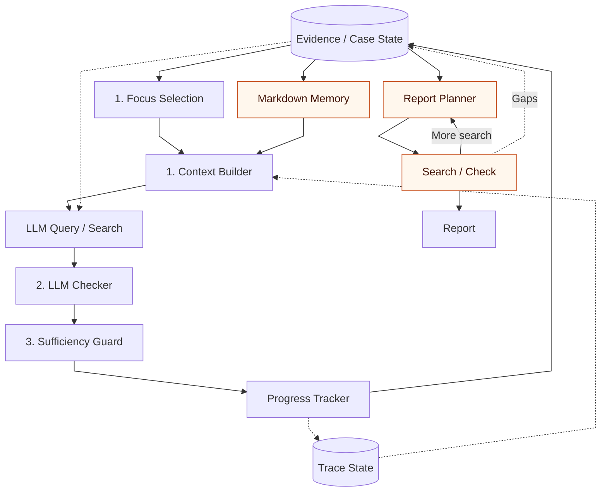
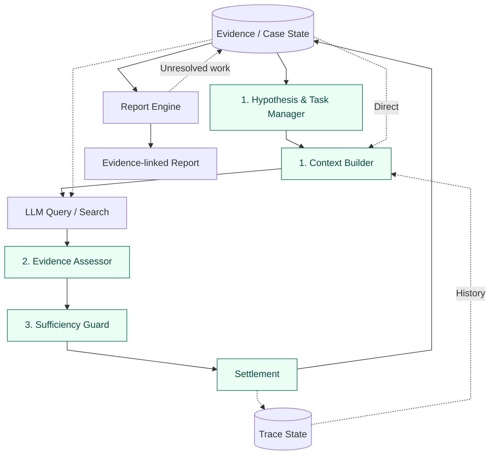

# 続・ローカルLLMはフォレンジック調査官の夢を見るか
ARTEXを参考に、フォレンジックハーネス「FORENSIA」のループを改善した話。

## はじめに

私は、「[FORENSIA](https://github.com/sumeshi/forensia)」というデジタルフォレンジックハーネスを作っています。

このハーネスは、Windowsアーティファクトを取り込み、ローカルLLMを使って調査仮説を立て、証拠をもとに検証し、その結果を報告書にまとめることができます。

なぜこれを作りたかったか、というと、攻撃側が防御側に押し付けるコストを、少しでも減らしたかったからというのが大きいです。  
生成AIの進化によって攻撃のハードルが低くなり、その分、防御側に押し付けられる負担が増えています。防御側もAIを活用しなければ到底追いつきません。

実際に、2026年9月以降、国内でもサイバー攻撃による被害公表が相次いでいます。こうした状況を見ると、防御にAIを活用する取り組みの優先度も、引き上げるべきなのだろうなと感じます。  
一方で、AI活用というとまだDXやAXの文脈で語られることが多く、攻撃への備えという点ではだいぶ周回遅れになってしまっているのが実情です。

それらの情勢を踏まえて我々が何をすべきか考えるには、やはりRED側の状況も知らないといけないんですよね。

最近、自律的なペネトレーションハーネスとして、ARTEXが話題になりました。なんでも、中国・成都にて行われたAI攻防能力コンテストで優勝したとか。これがOSSとして出されたことで注目を浴び、無数にフォークが作られ、結果的に攻撃のハードルが下がってしまった部分もあるでしょう（実際にそれが今流行っている攻撃に使われているかは別として）。

開発者にとっては望まない結果であり、現在リポジトリは非公開になっているのですが、ARTEXのアーキテクチャ自体は洗練されていて、AIハーネス全般に使える考え方だなと感じました。

本記事では、ARTEXの考え方をFORENSIAに取り入れながら学んだことをまとめていきます。

https://github.com/sumeshi/forensia

> FORENSIA開発の詳しい背景は、[前回の記事](https://sumeshi.github.io/posts/works/do-localllms-dream-of-forensic-investigator) をご参照ください。ただし、この記事は2026年5〜7月ごろまでの状況を踏まえたものであり、現在の状況とは異なる場合があります。

## 設計原則

LLMを取り巻く開発では、Prompt Engineering から、Context Engineering、Harness Engineering、Loop Engineeringと、設計する対象が広がってきました。

これは、LLMにできることが増えたのもありますが、LLMによって開発自体が爆速になったことも大きいと思います。コードを生成し、試し、書き直すサイクルが速くなるほど、個々の実装よりもその流れをどう組み合わせるかという設計の重要度高くなります。

特にLLMと密接なかかわりのあるAIハーネスでは、モデルの進化に追従できる、長寿妙なアーキテクチャを考えたいところです。**Pyramid of Pain** のように、変わりやすい個別の要素より、変わりにくい構造に目を向ける感じかな。

FORENSIAでも、調査の計画、実行、状態管理、検証、報告といった責務と、そのつながりを強く意識しています。**モデルやツールが変わっても、全体を作り直さずに必要な部分を交換できる構造** を目指しています。

まず、FORENSIAでは次の三つを設計原則としています。

### 1. 孤独に戦う

機密性の高い証拠を外部へ送らず、完全に隔離された環境でも調査を続けられることを重視しています。証拠の保存、検索、調査状態の管理、LLMによる推論まで、すべてをローカルで完結できるようにしています。

[FORENSIA: ローカルLLMフォレンジックハーネス](https://speakerdeck.com/sumeshi/forensia-rokarullmhuorenzitukuhanesu?slide=3)

もちろん、マネージドのLLMサービスを使う選択肢もありますが、フォレンジック用途なら手元だけで動かせるのがベストだと思っています。

また、今のようにモデルを気軽に手に入れたり、推論を安く使える状況がいつまで続くかも分かりません。特定のサービスに頼らず、手元で動かせる選択肢は残しておきたいところです。

### 2. LLMに過剰な期待をしない

LLMには、仮説の生成、検証方針の提案、証拠の解釈など、決定論的なプログラムでは扱いにくい処理を任せます。一方、証拠検索の実行、操作の制限、検証条件の評価、調査状態の更新は、可能な限りハーネス側で機械的に処理します。

手元で無理なく動かせる小型モデルに、調査の計画から結論まですべてを任せるのは厳しいです。性能が向上し、動かすためのノウハウがたまってきたとしても、間違えたり、前の作業を忘れたりすることは前提にしておく必要があります。

私がローカルLLMに求めているのは、**必要な情報と指示を与えれば、ちゃんとそのとおりに動いてくれること**です。もちろん、良いモデルを使ってパワーでゴリ押せばよい結果は出ますが、そこに依存しない手段も模索すべきかなと。

ちなみに、使用モデルとしては、[Ornith-1.5-9B](https://huggingface.co/ornith-ai/Ornith-1.5-9B)がパラメータ数の割に優秀です。9Bという小さなモデルながら軽快に動き、長時間走らせても同じ思考を繰り返したり、無意味に発散したりしにくい。そういう意味で、エージェントとしての性能が高いと感じています。

こうした小型モデルの限界を踏まえて、調査全体をいい感じにコントロールするのが、このハーネスの役割です。

> なぜ小型モデルか、という話は [AIにフォレンジックさせるのをやめよう](https://sumeshi.github.io/posts/works/dont-make-ai-your-forensic-analyst) でも書いているので、気になる方はそちらを参照してください。

### 3. 時間は湯水のごとく使う

一度の推論で正解を得る必要はありません。そんなことは人間にも難しいでしょう。

ログやアーティファクトを全部食わせて、一度に調べさせる構成にはしません。起点となる事象から仮説を立て、証拠を調べ、別の可能性も検討しながら、少しずつ調査を進めます。

何を調べ、何が分かり、どこで失敗したのかを記録し、次の調査に生かします。ただし、時間を使えることと、同じ失敗を繰り返してよいことは別です。進捗や検証可能性、実行予算をもとに、調査の継続と終了を判断します。

## 設計を見直した背景

初期のFORENSIAは、コーディングエージェント、とりわけ [Pi Coding Agent](https://github.com/earendil-works/pi) を意識して設計しました。コーディングと調査は違いますが、情報を得て、操作を実行し、その結果から次の行動を決めるというループ構造は共通しています。

当時から、単にループを回すだけでなく、人が逐一指示しなくても長時間動かすにはどうすればよいかを模索していました。

個々の仮説を検証する処理だけでは、調査全体の面倒を見きれません。どの仮説から調べるのか。行き詰まった作業をいつ保留するのか。証拠が追加されたら、どこから再開するのか。一つの検索が成功したかどうかとは、別に判断する必要があります。

## ARTEXのアーキテクチャ

ARTEXは、LLMを使ってペネトレーションテストを自律的に進めるハーネスです。Go製のバックエンドとNext.jsのWeb UI、PostgreSQLなどで構成されており、中心となるのはPlannerとWorkerという二つの役割を持つエージェントです。

Plannerは調査全体の状況を把握し、次に何をするべきかを考えます。一方、WorkerはPlannerから割り当てられた個々の作業（Intent）を実行し、ツールを使って情報を収集します。

この作業の進捗を管理するために、ARTEXでは二種類のグラフを使っています。

一つは、ドメインやIPアドレス、サービスなどの調査対象を管理するAsset Graph。もう一つは、調査の目標（Goal）、作業（Intent）、得られた事実（Fact）、発見（Finding）などの関係を管理するExploration Graphです。

大まかな流れとしては、PlannerがExploration Graphから現在の状況を読み取り、次のIntentを発行します。Workerがそれを実行し、得られた結果をグラフへ保存すると、その変更をきっかけにPlannerが再び起動します。これを繰り返すことで、調査を進めていく仕組みです。

また、Plannerは実行をまたいで共有するTodoを持っており、作業の依存関係を考慮しながら次のIntentを発行します。Workerの実行過程も記録されるため、最終的な発見だけでなく、途中で何を試したのかも後続の作業に利用できます。

**Plannerがすべての作業を一度に計画・実行するのではなく、Workerの結果を受け取るたびに、次の計画を考え直す**という構造は、フォレンジック調査にも通じるものがあります。最初からすべての調査手順を決められるわけではなく、証拠を見つけ、その結果から次に何を調べるべきかを考える必要がある、というのはLLM登場以前の方法では難しかったポイントです。

こういった考え方をもとに、FORENSIAでは、調査状態（Case State）と試行履歴（Trace State）を使って作業を管理し、選択した仮説の検証結果を次の作業選択へ戻す構成に再設計しました。

## 変更前後の構成

以前のFORENSIAにも、仮説に優先順位を付けて検証する仕組みはありましたが、調査全体の作業管理はまだ十分ではなく、候補となる仮説を順に試していく構成でした。

また、調査状態の一部をMarkdownの記憶文書へ射影し、それを次の作業へ渡すことでコンテキストを管理していました（これは人間が調査の過程を追いやすくするという意図もありましたが）。

さらに、仮説の検証だけでは報告書に必要な情報が揃わないため、報告書側にもLLMによる計画・検索・判定の独立したループを設けていました。

図1. 以前の構成の概略。橙色は今回廃止した部分です。

こうした構成を見直すにあたり、ARTEXを参考に、調査全体の作業管理と個々の検証処理の関係を整理しました。作業の選択、保留、再開で判断が食い違わないようにし、検証結果を次の作業へ引き継ぐ仕組みを改善しています。

また、Markdownの記憶文書を介さず、DBから直接コンテキストを組み立てるようにしました。報告書側の独立した探索ループも調査側へ統合しています。

証拠の評価についても、個々の証拠が検証条件を満たしているかと、その証拠で結論を出してよいかを分けて扱うようにしました。

図2. 今回の構成の概略。緑色は主な変更箇所です。Evidence、Case State、Trace Stateは、現在は一つのDuckDBで管理しています。

以下では、作業の選択と状態の引き継ぎ、Evidence Assessor、Sufficiency Guardの三つに分けて説明します。

### 1. 作業の選択と状態の引き継ぎ

長時間の調査を続けるには、次に何を調べるかを決めるだけでなく、それまでに何を調べ、何が分かっているのかを引き継ぐ必要があります。

今回、Hypothesis & Task Managerでは、仮説の優先順位だけでなく、必要な証拠や作業の依存関係、過去の試行などを考慮して、次の作業を選ぶ仕組みを整理しました。進められない作業は理由と再開条件を残して保留し、同じ失敗を繰り返さないようにしています。

もう一つ重要なのが、Context Builderです。

調査状態をCase State、検索や判断の履歴をTrace Stateとして保存していますが、そのすべてをLLMに渡すわけではありません。Context Builderが、現在の仮説、関連する証拠、満たしていない条件、未解決の作業、過去の試行などを取り出し、Working Stateとして組み立てます。必要なスキーマや検索方法も、作業に応じて提供します。

以前のMarkdownによる記憶管理には、モデルに渡す情報を整理しやすく、人間も調査の過程を確認できるという利点がありました。ただ、調査全体の状態を使って作業を管理するようになると、記憶文書を介するより、DBからその都度必要な情報を組み立てる方が都合がよくなります。

そこで、Case StateとTrace Stateから直接Working Stateを構成する方法に変更しました。

Hypothesis & Task Managerが次に何をするかを決め、Context Builderがそのために何をモデルへ見せるかを決める。モデル自身に長い調査のすべてを覚えてもらうのではなく、ハーネス側が必要な情報を揃えて渡すという考え方です。

### 2. 証拠が検証条件を満たしているかを確かめる

以前は、検索結果をLLM Checkerに渡し、仮説を支持するかどうかの判定を提案させていました。もちろん、その後にも検証処理はありましたが、個々の証拠をどう評価するかについて、LLMに依存する部分がありました。

そこで、今回その役割を整理したのがEvidence Assessorです。

検索で情報が見つかったことと、それが仮説の裏付けになることは別です。LLMが「これが証拠です」と説明しても、実際には別の対象の記録だったり、確認したかった条件を満たしていなかったりする可能性があります。

Evidence Assessorでは、あらかじめ保存した検証条件に従って証拠を評価します。このとき、モデルの説明やSQLで加工された値をそのまま根拠にはせず、Evidence IDから正規化済みのレコードを取り直して照合します。

また、特定のフィールドと比較条件で表現できる確認は、型付き観測としてコードで処理します。こうした処理では、検索の組み立てから条件の照合まで、LLMに任せずに済む場合があります。

LLMには何を調べるかを考えてもらい、条件に合っているかは可能な限りコードで確かめる。 小型モデルに余計な判断を任せないための工夫です。

### 3. その証拠で結論を出してよいかを確かめる

証拠が検証条件を満たしていても、それだけで十分な裏付けがあるとは限りません。個々の証拠を評価した結果を受け取り、結論を採用できるか確認するのがSufficiency Guardです。

この仕組み自体は以前からありましたが、今回、Evidence Assessorとの責務を明確にし、根拠の独立性や観測可能な範囲などを踏まえて評価する処理を整理しました。

たとえば、同じ証拠を何度検索しても、裏付けが増えたことにはしません。別々のレコードであっても、同じ原本から派生したものなら、独立した証拠として数えないようにしています。

また、検索結果が0件だったとしても、必要なログが取得されていなければ、活動がなかったとは判断できません。そこで、どのような証拠が利用でき、何を観測できるのかをCoverageとして管理し、反証に使える条件が揃っているかを確認します。

こうした評価を踏まえて、最後にSettlementで正式な判定を確定します。根拠が不足していれば無理に結論を出さず、未解決の事項として残します。

証拠が条件を満たすことと、その証拠で結論を出してよいことは別です。 この二段階の評価を通して、モデルの提案を調査の結論として採用してよいかを判断します。

## 評価について

今回の変更で期待しているのは、単純な正答率の向上だけでなく、長時間の調査を通じて一貫性を保てるようになることです。

まず、作業管理とContext Builderを改善したことで、過去の試行や未解決事項を踏まえて次の作業を選べるようにしています。同じ検索を繰り返したり、途中で調査目的を見失ったりする問題を減らし、限られたコンテキストを有効に使うことが狙いです。

また、Evidence Assessorによって、LLMが提案した検索結果をそのまま信用せず、実際の証拠と検証条件を照合するようにしました。これによって、証拠の取り違えや、検索結果を都合よく解釈してしまう問題を抑えられると考えています。条件で確認できる処理をコードに任せることで、LLMの呼び出しや判断の負担も減らせるはずです。

さらに、Sufficiency Guardでは、証拠が条件を満たしていることと、結論を出すのに十分な裏付けがあることを分けて扱います。複数の検索で同じ証拠が見つかっただけなのに確信を強めたり、必要なログがないのに「活動はなかった」と判断したりすることを防ぐためです。

つまり、**モデルの推論能力そのものを高めるのではなく、モデルが間違えやすい部分をハーネスで補う**というアプローチです。

今回もCFReDSのData Leakage Caseを使って検証しています。正答率については以前と大きな違いはありませんでしたが、調査結果の破綻は少なくなったように感じています。

例えば、証拠が見つかっても、それだけで不正行為があったと断定しないこと。検証できていない検索結果を回答に混ぜず、根拠が不足している仮説は未解決として残すこと。こうした振る舞いは、以前より安定してきた印象です。

一方、慎重になりすぎて、答えられるはずの問いまで未解決にしてしまう問題もあります。結局のところ、**間違った結論を出さないことと、正しい結論を出せることは別**なんですよね。まだまだ改善の余地はありそうです。

ただし、これは正式なベンチマークによる評価ではなく、旧バージョンと実行結果を比較したうえでの差異です。
答え付きで調査可能なケースがすくないのと、1回の調査に1〜2時間ほどかかるため、十分な試行回数を確保するのが難しく、正答率だけでなく、調査の一貫性や結論の妥当性も効率よく比較・評価できる方法は引き続き模索中です。

## おわりに

今回は、ARTEXに触発されて、FORENSIAの調査ループを見直してみました。

調査全体の作業管理やコンテキストの構成、証拠の評価と結論の採用など、モデルに任せていた部分をハーネス側でうまく制御できないかと考え、あれこれ手を加えています。

また、本文では触れませんでしたが、Webでレポートを確認する仕組みを廃止して調査ロジックの改善に集中したり、Sigmaルールに対応させたりと、細かい変更も加えました。機能を増やすだけでなく、全体としてはなるべくシンプルにしていきたいと考えています。

一方、ローカルLLMを取り巻く環境も変わりつつあります。最近は、[Colibri](https://github.com/JustVugg/colibri)、[AirLLM](https://github.com/lyogavin/airllm)、[FreeToken](https://github.com/FlashML-org/FreeToken)、[Strata](https://github.com/Niko1221/Strata)のように、モデル全体をVRAMに載せず、メインメモリやストレージも活用して推論する仕組みが増えてきています。

動かせることと実用的な速度で使えることは別ですが、モデルの進化だけでなく、こうした推論環境側の工夫も効いてくるんじゃないかなと思っています。

とはいえ、**やっぱりローカルLLMは厳しい！**

おしまい
